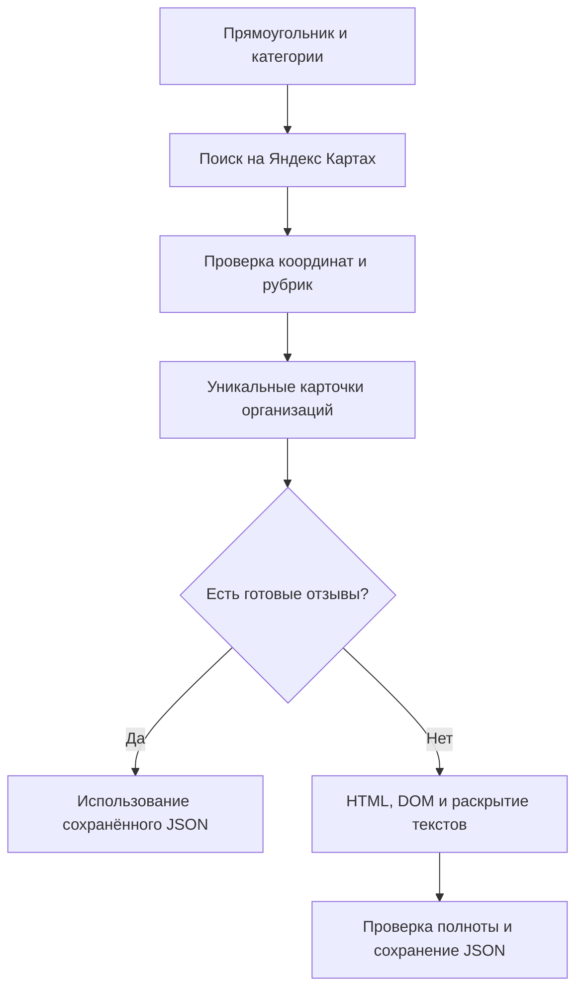

# 🗺️ Yandex Maps Reviews

Поиск организаций по выбранной территории и категориям, затем сбор текстов отзывов и индивидуальных оценок с Яндекс Карт. Программа открывает публичные страницы в Chromium, читает HTML и DOM, проверяет координаты и рубрики, раскрывает сокращённые тексты и сохраняет результаты в JSON.

Для запуска нужны **Python 3.11 или новее**, интернет и Chromium, устанавливаемый средствами Playwright. Проверенная конфигурация: Windows, Python 3.11.7, Playwright 1.52.0, Chromium 138. Работа в Linux и macOS отдельно не проверялась.

## ✨ Что умеет сборщик

- Принимает ссылку на организацию или её числовой идентификатор; поддерживает несколько карточек за запуск.
- Самостоятельно находит ссылки по выбранной территории и категориям; готовые идентификаторы вручную вводить не требуется.
- Принимает прямоугольник, нарисованный полигон или границу GeoJSON, включая отдельные контуры и отверстия.
- Предлагает поиск города в локальном каталоге границ, 20 готовых поисковых категорий и собственные поисковые запросы.
- По умолчанию собирает все доступные текстовые отзывы; необязательный лимит выбирает самые свежие отзывы каждой организации.
- Сохраняет текст, оценку от 1 до 5, автора, публичную ссылку на профиль и дату каждого отзыва.
- Получает название, адрес, координаты, категории, общую оценку и счётчики организации, когда эти сведения присутствуют на странице.
- Использует полные тексты из встроенного HTML, чтобы не раскрывать уже полученные отзывы повторно.
- Сохраняет промежуточные результаты и использует их при следующем запуске.
- Различает полный сбор, достижение лимита, неполные поля и расхождение со счётчиком сайта.
- Делает ограниченное число повторов после HTTP 429 с увеличением паузы и учётом `Retry-After`.

**Ключи доступа и API Яндекс Карт не требуются.** Сборщик не вызывает отдельные служебные методы получения отзывов и не читает содержимое их ответов. Данные извлекаются из HTML публичной страницы и её DOM. Сам сайт при работе в браузере может выполнять собственные сетевые запросы; их коды и заголовки учитываются для обнаружения ограничений доступа.

## 🚀 Быстрый запуск

Скачайте или скопируйте репозиторий и откройте терминал в его папке. Команды ниже создают отдельное окружение, устанавливают зависимость и браузер.

### Windows · PowerShell

```powershell
# Создаём окружение; требуется установленный Python 3.11 или новее.
python -m venv .venv
# Устанавливаем зависимость в это окружение.
.\.venv\Scripts\python.exe -m pip install -r requirements.txt
# Устанавливаем Chromium, совместимый с Playwright.
.\.venv\Scripts\python.exe -m playwright install chromium
# Собираем все доступные отзывы указанной организации.
.\.venv\Scripts\python.exe collect_yandex.py 44307431220
```

### Linux и macOS

```bash
# Создаём отдельное окружение Python.
python3 -m venv .venv
# Устанавливаем зависимость в это окружение.
.venv/bin/python -m pip install -r requirements.txt
# Устанавливаем совместимый Chromium.
.venv/bin/python -m playwright install chromium
# Собираем все доступные отзывы указанной организации.
.venv/bin/python collect_yandex.py 44307431220
```

В Linux при сообщении о недостающих системных библиотеках выполните `python -m playwright install-deps chromium` тем Python, которым установлен Playwright. Установка системных библиотек может потребовать административных прав.

После полного сбора в папке `review_results/` появится файл `<идентификатор организации>.json`. При заданном лимите создаётся отдельный файл, например `<идентификатор>.limit50.json`: ограниченная выборка не затирает полный снимок. В терминале отображаются открытие карточки, паузы и итоговые счётчики. Обработка завершается без отдельного окна браузера.

## 📍 Поиск по территории и категориям

После установки зависимостей откройте терминал в папке репозитория и запустите страницу выбора территории:

```powershell
# Отдаём только локальные файлы интерфейса; этот сервер не собирает отзывы.
.\.venv\Scripts\python.exe -m http.server 8000 --bind 127.0.0.1
```

Откройте [карту выбора территории](http://127.0.0.1:8000/select_area.html). Выберите область одним из четырёх способов:

- **Прямоугольник:** приблизьте участок, нажмите «Выделить прямоугольник» и протяните рамку.
- **Полигон:** нажмите «Нарисовать полигон», отметьте вершины и нажмите первую вершину для завершения. Esc отменяет рисование, сохраняя прежнюю выбранную область.
- **Файл:** загрузите GeoJSON с `Polygon`, `MultiPolygon`, объектом `Feature` или непустой полигональной `FeatureCollection`. Все объекты коллекции образуют одну территорию; перекрывающиеся части объединяются.
- **Город:** введите название в поле локального каталога и нажмите найденный вариант. Карта покажет его контур.

Затем выберите категории и при необходимости добавьте свои запросы. Нажмите **«Скачать area.json»** и поместите файл в папку репозитория. Для отображения карты нужен интернет: Leaflet загружается с CDN, подложка — обычные изображения OSM. Границы городов читаются из локальных файлов; организации из OSM не извлекаются.

В другом терминале той же папки выполните:

```powershell
# Находим организации и собираем все доступные отзывы каждой.
.\.venv\Scripts\python.exe discover_yandex.py --config area.json --with-reviews
# Для первого запуска можно задать небольшой объём: 3 организации на категорию и 20 отзывов на каждую.
.\.venv\Scripts\python.exe discover_yandex.py --config area.json --max-orgs 3 --with-reviews --review-limit 20
```

В Linux и macOS используйте `.venv/bin/python` вместо `.\.venv\Scripts\python.exe`. Статический сервер нужен только для выбора территории; после сохранения конфига его можно остановить клавишами Ctrl+C.

Карту можно пропустить и передать границы напрямую. Порядок — **запад, юг, восток, север**, то есть две пары **долгота, широта**:

```powershell
# Ищем кафе и школы в небольшом прямоугольнике Томска, пока без отзывов.
.\.venv\Scripts\python.exe discover_yandex.py --bbox 84.965 56.455 85.005 56.485 --categories cafe school --max-orgs 5
# Выводим все готовые категории и рубрики без запуска браузера.
.\.venv\Scripts\python.exe discover_yandex.py --list-categories
# Ищем другую категорию явным свободным запросом.
.\.venv\Scripts\python.exe discover_yandex.py --bbox 84.965 56.455 85.005 56.485 --query "дом культуры"
```

`area.example.json` содержит примерные границы прямоугольника и категории. В конфиге `bbox` обозначает рамку поиска, `categories` — ключи готовых категорий, `queries` — свободные запросы. Для полигона добавляется `geometry` с точным GeoJSON; необязательный `area_source` хранит название, источник и дату снимка. Геометрия не заменяется рамкой при проверке организаций. Если `geometry` задана без `bbox`, рамка вычисляется автоматически; если заданы оба поля, они должны совпадать.

Локальный GeoJSON можно передать без карты:

```powershell
# Используем точную границу из своего файла и собираем отзывы найденных кафе.
.\.venv\Scripts\python.exe discover_yandex.py --geometry city.geojson --categories cafe --with-reviews
```

Координаты — **WGS84, долгота и широта**, без высоты и поля `crs`. Метрические координаты нужно предварительно преобразовать. Файл конфига или GeoJSON ограничен 10 МБ; одна геометрия — 200 000 вершин. Сборщик отклоняет незамкнутые контуры, самопересечения, неверные отверстия, нулевую площадь и некорректные числа до открытия Яндекса. Контуры не упрощаются и не исправляются автоматически. Переход через 180-й меридиан не поддерживается. Проверка файла в интерфейсе предварительная; полную проверку топологии выполняет Python при запуске.

Поиск и отзывы выполняются в одной вкладке и одной браузерной сессии. Перед переходом к следующей поисковой странице или карточке выдерживается пауза. Повторный запуск проверяет совместимость поисковых снимков и отзывов; если всё готово, браузер не запускается.

## 🏙️ Локальный каталог границ

В комплекте находятся **Москва и Санкт-Петербург**, административные границы из файловой выгрузки OSM [missinglink/osm-boundaries](https://github.com/missinglink/osm-boundaries). Это **архивный снимок за 8 декабря 2016 года**, а не подтверждённые актуальные границы. Дата показывается до выбора города и сохраняется в конфиге. Для текущего исследования проверьте границу и при необходимости загрузите более свежий GeoJSON. Москва здесь означает территорию города федерального значения, включая отдельные контуры, а не только участок внутри МКАД.

Поиск города работает по названию и вариантам написания из `boundaries/catalog.json`, без Nominatim, Overpass или другого геокодирующего API. Он ограничен содержимым каталога. Файлы контуров загружаются только после выбора города; все границы сразу не читаются.

Чтобы добавить город, поместите его полигональный GeoJSON в `boundaries/` и добавьте запись в `cities` файла `boundaries/catalog.json`. Укажите уникальный `id`, `name`, понятный `label`, список `aliases`, относительный `file`, дату снимка `snapshot` и ссылку `source_url`. Для пути используйте латинские строчные буквы, цифры и дефисы: например, `boundaries/tomsk.geojson`. Проверьте файл командой `python test_geometry.py -v`. После перезагрузки страницы новая запись появится в поиске. Нужную границу также можно загрузить через интерфейс, не изменяя каталог.

Данные границ имеют отдельную лицензию ODbL 1.0 и указание источника © OpenStreetMap contributors; подробности — в [описании каталога](boundaries/README.md).

## 🏷️ Откуда берутся категории

У Яндекса есть публичный [рубрикатор мест и организаций](https://yandex.ru/support/nmaps/ru/app_poi): в нём перечислены категории, подкатегории и рубрики. Номера разделов в справочнике не являются идентификаторами для поискового запроса. Справочник [видов деятельности с онлайн-записью](https://yandex.ru/support/business-priority/ru/manage/categories-booking) имеет более узкое назначение и не заменяет общий рубрикатор.

В `categories.json` находятся **20 предустановок поиска**, а не все рубрики Яндекса. Например, `cafe` означает запрос «кафе» с проверкой рубрики «Кафе», `school` — запрос «общеобразовательные школы» с проверкой рубрики «Общеобразовательная школа». Категорию можно выбрать по ключу или по русскому названию из файла. В интерфейсе список загружается из этого же JSON, поэтому отдельный список для карты поддерживать не нужно.

Для каждой предустановки задаются `label`, `query` и `rubrics`. Программа сравнивает разрешённые названия с фактическими рубриками найденной организации, игнорируя регистр, лишние пробелы и различие е/ё. Подходящая рубрика должна присутствовать явно. Результат запроса «кафе» с единственной рубрикой «Ресторан» автоматически не принимается.

Все настройки файла проверяются автономными тестами. Живой поиск проверен для кафе и общеобразовательных школ; остальные предустановки требуют проверки на выбранной территории. Если Яндекс использует другое название рубрики, запись сохранится как `rubric_mismatch`: проверьте её и уточните список `rubrics`. При добавлении новой предустановки ориентируйтесь на официальный справочник и рубрики, фактически полученные из карточек. Сборщик не обращается к служебному API рубрикатора.

Свободный `--query` позволяет искать любую другую категорию или название без изменения файла. Для него проверяются ссылка и положение организации, а заранее заданная рубрика не проверяется. Это явно отражено пустым списком `rubrics` в параметрах поискового снимка.

**«Дом» и «жилой комплекс» — разные объекты.** Адресное здание не обязательно имеет карточку организации с отзывами. Для недвижимости предусмотрены `residential` и `cottage`: жилые комплексы и коттеджные посёлки. Их особенности описаны в [справке Яндекс Бизнеса](https://yandex.ru/support/business-priority/ru/add-company/residential-estate). Обычные здания без карточки организации не передаются сборщику отзывов.

## 🔎 Как проверяется поисковая выдача

Поисковая страница получает центр и размер выбранного участка, но эти параметры не гарантируют строгие границы выдачи. Поэтому модуль дополнительно проверяет фактические координаты каждой найденной организации. Если они неизвестны, объект не попадает в очередь отзывов; центр области вместо координат организации не подставляется.

Кандидаты сохраняются с полем `selection_status`: `accepted`, `outside_bbox`, `outside_polygon`, `missing_coordinates`, `rubric_mismatch` или `missing_rubrics`. В `organizations` попадают только принятые записи, подтверждённые текущим посещением страницы. Дубликаты между категориями объединяются по идентификатору Яндекса; `found_by` содержит категории или запросы, по которым найден объект. При ограничении новой попытки прежние кандидаты сохраняются с `seen_in_current_run = false` и не передаются сборщику отзывов автоматически.

Охват обозначается как `visible_search_results_only`. Модуль собирает доступную поисковую выдачу и **не гарантирует полный перечень организаций территории**. Географические границы проверяются по точке организации: внутри полигона либо на его границе, вне внутренних отверстий; полнота каталога — отдельная задача. Автоматическое разбиение большой области на участки в эту версию не входит.

| Файл внутри `--output` | Содержание |
|---|---|
| `organizations.json` | Объединённый список организаций, границы и состояния поисковых заданий |
| `search/<ключ>.json` | Кандидаты, причины исключения, параметры и сетевые показатели одного поиска |
| `reviews/<идентификатор>.json` | Полный сбор отзывов найденной организации при `--with-reviews` |
| `reviews/<идентификатор>.limit50.json` | Выборка до 50 свежих отзывов при заданном лимите; число в имени соответствует лимиту |
| `review_jobs.json` | Краткие итоги карточек, фактически обработанных при последнем запуске |

Файлы исходного запуска `collect_yandex.py` сохраняются непосредственно в его `--output`; поиск через `discover_yandex.py` использует вложенную папку `reviews/`.

| Параметр поиска | По умолчанию | Назначение |
|---|---|---|
| `--bbox` | Не задан | Четыре границы области; имеет приоритет над файлом |
| `--config` | Не задан | Экспортированный JSON выбора территории и категорий |
| `--geometry` | Не задан | Отдельный локальный GeoJSON с точной границей; имеет приоритет над geometry из конфига |
| `--categories` | Из конфига или пустой список | Ключи либо русские названия предустановок |
| `--query` | Из конфига или пустой список | Свободный запрос; параметр можно повторять |
| `--list-categories` | Выключен | Показать предустановки без браузера и сети |
| `--max-orgs` | `20` | Максимум принятых организаций **на запрос**, от 1 до 100 |
| `--with-reviews` | Выключен | Передать найденные карточки сборщику отзывов |
| `--review-limit`, `--max-reviews` | Все отзывы | Необязательный положительный максимум свежих отзывов каждой организации |

Параметры `--output`, `--pause`, `--scroll-pause`, `--429-retries`, `--executable` и `--refresh` имеют тот же смысл, что у отдельного сборщика отзывов. Поисковые статусы: `capped` — достигнут заданный объём; `visible_results_exhausted` — три прохода не дали новых идентификаторов; `time_budget` и `scroll_budget` — достигнут бюджет попытки. Ошибка, CAPTCHA или 429 не считаются отсутствием организаций. При ограничении доступа последующие запросы и сбор отзывов останавливаются.

## 🔗 Как передать организации

Можно использовать обычную ссылку из адресной строки Яндекс Карт. Параметры после `?` не требуются. Ссылку заключайте в кавычки.

```powershell
# Передаём ссылку на страницу отзывов и повышаем лимит до 150.
.\.venv\Scripts\python.exe collect_yandex.py "https://yandex.ru/maps/org/-/44307431220/reviews/" --limit 150
# Последовательно собираем две карточки с паузой 30 секунд между ними.
.\.venv\Scripts\python.exe collect_yandex.py 44307431220 1245233699 --limit 150 --pause 30
# Обновляем ранее завершённый результат, повторно открывая страницу.
.\.venv\Scripts\python.exe collect_yandex.py 44307431220 --limit 150 --refresh
# Сохраняем результаты в выбранную папку.
.\.venv\Scripts\python.exe collect_yandex.py 44307431220 --output "my_reviews"
```

Отдельный `collect_yandex.py` принимает HTTPS-ссылки на карточки организаций с доменами `yandex.ru` и `yandex.com`, а также числовые идентификаторы. Сокращённую ссылку сначала откройте в обычном браузере и скопируйте полный адрес. Для автоматического получения карточек используйте `discover_yandex.py`.

## ⚙️ Параметры

| Параметр | По умолчанию | Назначение |
|---|---|---|
| `urls` | Обязателен | Одна или несколько ссылок либо числовых идентификаторов |
| `--limit`, `--max-reviews` | Все отзывы | Необязательный положительный максимум свежих отзывов на каждую организацию |
| `--output` | `review_results` | Папка JSON-файлов; одновременно используется для возобновления |
| `--pause` | `20` | Пауза между открываемыми карточками, секунды; не менее 10 |
| `--scroll-pause` | `5` | Пауза после прокрутки, секунды; не менее 3 |
| `--429-retries` | `3` | Число повторов после исходной попытки с HTTP 429; от 0 до 3 |
| `--refresh` | Выключен | Повторно открыть карточки с готовым сохранённым результатом |
| `--executable` | Не задан | Путь к исполняемому файлу установленного Chromium |
| `--help` | — | Показать справку |

Без `--limit` или `--review-limit` программа пытается собрать все доступные текстовые отзывы. При значении `50` выбираются **до 50 самых свежих отзывов каждой организации**; если отзывов меньше, собираются все имеющиеся. Ноль и отрицательные значения отклоняются. Лимит не относится к сумме отзывов всех организаций.

Если отзывов больше лимита, сборщик выбирает «По новизне» через меню страницы и проверяет даты видимых записей. Если порядок нельзя подтвердить, результат получает `sort_unavailable`: популярная выдача не выдаётся за свежую. Для полного сбора больших карточек также выбирается «По новизне»: выдача «по умолчанию» может перестать подгружать данные раньше счётчика. Небольшие карточки до 50 отзывов можно упорядочить локально; все полученные записи сохраняются от свежих к старым по доступным датам. Это даты, отображаемые источником, включая возможные обновления отзывов.

```powershell
# Собираем все доступные отзывы одной организации.
.\.venv\Scripts\python.exe collect_yandex.py 44307431220
# Получаем до 50 самых свежих отзывов организации.
.\.venv\Scripts\python.exe collect_yandex.py 44307431220 --max-reviews 50
# Получаем до 50 самых свежих отзывов каждой найденной организации.
.\.venv\Scripts\python.exe discover_yandex.py --config area.json --with-reviews --max-reviews 50
```

Статус `capped` означает достижение заданного максимума, а не полное число отзывов организации. Полный сбор не ограничен 300 записями, 25 прокрутками или 240 секундами; большое число отзывов потребует больше времени. Ошибки доступа и три ожидания без новых карточек завершают попытку с сохранением данных. Проверяйте итоговый статус: отсутствие лимита не превращает частичный результат в полный.

## 🔄 Загрузка и возобновление



Программа сначала проверяет JSON: организацию, версию формата, уникальность ключей, наличие текста и даты, целую оценку 1–5 и отсутствие сокращённых текстов. Результат `complete` используется повторно, если число записей соответствует сохранённому счётчику. Результат `capped` используется только для ограниченного сбора с подтверждённой сортировкой по новизне. Для полного сбора он не подходит. Готовый полный снимок позволяет создать меньшую свежую выборку локально, без браузера; собственный файл выборки хранится отдельно. Старый ограниченный кэш без подтверждения сортировки потребует нового посещения. Если все карточки уже готовы, браузер вообще не запускается.

При незавершённом сборе повторите ту же команду с той же папкой `--output`. Страница откроется заново, а сохранённые полные тексты помогут избежать повторного раскрытия. Это повторный проход по странице, а не продолжение с конкретной позиции прокрутки. При успешном завершении в снимке остаются отзывы, подтверждённые текущим DOM. При остановке сохраняется накопленный прогресс, который может включать записи предыдущей попытки.

`--refresh` повторно посещает карточку, сохраняя возможность использовать уже полученные тексты. Для полностью нового снимка укажите другую папку `--output`. Файл кэша является снимком: без обновления новые отзывы на сайте не проверяются. Повреждённый JSON или неверная структура автоматически перемещаются в соседний файл `имя.broken-<время>.json`; оригинал сохраняется, а сбор начинается заново. Несовместимая версия формата или чужой идентификатор требуют отдельной папки результатов.

Запись выполняется через уникальный временный файл в той же папке, синхронизацию с диском и атомарную замену итогового JSON. При отказе записи прежний файл остаётся целым. Одна папка защищена системной блокировкой `.run.lock`: второй запуск получает понятную ошибку. После аварийного завершения процесса блокировка освобождается автоматически; удалять файл вручную не требуется. Разные папки этой блокировкой не связаны — запускайте сетевой сбор последовательно.

Файл `review_jobs.json` содержит состояние очереди, итоги попыток и `remaining_ids` — ещё не обработанные или прерванные карточки. `finished` означает, что очередь попыток завершена: проверяйте статусы отдельных результатов, поскольку среди них возможны ошибки или неполные поля. `stopped`, `interrupted` и `error` обозначают остановку; `cache_hit` — полностью готовый поисковый запуск из кэша. Для возобновления повторите прежнюю команду: готовые снимки будут пропущены, остальные проверены снова.

## 📦 Что находится в JSON

| Поле | Содержание |
|---|---|
| `schema_version` | Версия формата; сейчас `1` |
| `organization_id`, `url`, `final_url` | Организация, исходный и конечный адрес страницы |
| `collected_at` | Время начала последней попытки в UTC |
| `status`, `limit` | Состояние обработки и заданный максимум; `null` означает отсутствие лимита |
| `review_order` | Подтверждённый порядок `newest` для готового результата |
| `cache_source` | `complete_snapshot`, если ограниченная выборка создана из полного кэша без посещения сайта |
| `company` | Название, адрес, координаты, категории, общая оценка и счётчики |
| `reviews` | Отзывы: `id`, `author`, `author_url`, `date`, `text`, `rating`, `text_truncated` |
| `source_review_id` внутри отзыва | Исходный идентификатор из встроенного HTML, если доступен |
| `valid_reviews`, `truncated_count`, `invalid_rating_count` | Число полных записей, сокращённых текстов и нераспознанных оценок |
| `observed_this_run`, `observed_in_dom` | Число уникальных записей, найденных при последней попытке в HTML/DOM и отдельно в DOM |
| `elapsed_seconds`, `scrolls`, `expanded_texts` | Длительность последней попытки, число прокруток и раскрытых текстов |
| `network`, `attempts` | Счётчики загрузки, HTTP-ошибки и журнал попыток |

Координаты `company.coordinates_lon_lat` записываются как **[долгота, широта]**. Счётчик `ratings_count` включает оценки без текстового отзыва; его нельзя использовать как ожидаемое число записей `reviews`.

`reviews[].rating` — оценка конкретного отзыва. Общая оценка организации находится в `company.rating`. Если оценка отзыва не распознана, сохраняется `null`, без подстановки общего рейтинга.

`reviews[].id` — локальный SHA-256 ключ из организации, автора и даты; при отсутствии автора или даты дополнительно используется текст без пробелов по краям. Надпись интерфейса «Анонимный отзыв» считается отсутствующим именем, чтобы HTML и DOM давали один ключ. Он нужен для объединения записей, а не является исходным идентификатором Яндекса. Изменение даты или профиля может изменить этот ключ. Даты сохраняются в виде, полученном со страницы, без дополнительного пересчёта часового пояса. Недоступные сведения об организации могут отсутствовать или иметь значение `null`.

## 🚦 Статусы завершения

| Статус | Значение и следующее действие |
|---|---|
| `complete` | Все подтверждённые отзывы имеют обязательные поля, число совпало со счётчиком; также возможна карточка с нулём отзывов |
| `capped` | Получен заданный лимит полных отзывов; для большего объёма повысьте `--limit` |
| `count_mismatch` | Число найденных записей превышает счётчик страницы; записи сохранены, расхождение требует проверки |
| `incomplete_fields` | Достигнут счётчик или лимит, но у части записей нет полного текста, даты или оценки |
| `rate_limited` | Сайт вернул HTTP 429; после исчерпания повторов очередь остановлена |
| `captcha`, `access_denied` | Проверка пользователя или отказ в доступе; очередь остановлена |
| `stalled` | Три прокрутки подряд не дали новых карточек |
| `sort_unavailable` | Нельзя подтвердить выбор самых свежих отзывов; попытка сохранена как незавершённая |
| `timeout`, `server_error`, `error` | Ошибка ожидания, HTTP 5xx либо другая ошибка; подробности доступны в JSON |
| `not_found`, `http_error` | HTTP 404/410 либо другая ошибка открытия карточки |
| `browser_closed` | Браузер или вкладка закрылись; очередь остановлена |
| `interrupted` | Сбор прерван пользователем; накопленные данные сохранены |
| `running` | Промежуточный файл; обработка ещё идёт либо процесс завершился без финальной записи |

В терминале также встречается `cache_hit`: готовый файл использован без посещения сайта. Это событие, а не новый статус внутри сохранённого JSON. Для автоматической обработки проверяйте и поле `status`, и код завершения: `0` — все запрошенные попытки готовы; `1` — ошибка или незавершённый результат; `2` — неверные параметры; `130` — прерывание пользователем. У готового поиска возможен статус `visible_results_exhausted`: это исчерпание наблюдаемой выдачи, а не доказательство полноты городского каталога.

## ⏱️ Паузы и ограничения сайта

После HTTP 429 повторное открытие выполняется через 60, 120 и 240 секунд. При наличии `Retry-After` используется большая из этих задержек. Если сервер требует ждать более 900 секунд, программа сохраняет результат и завершает очередь, не отправляя преждевременный повторный запрос. CAPTCHA автоматически не решается.

После таймаута открытия страницы и HTTP 502/503/504 допускаются ещё две попытки с паузами 30 и 60 секунд. Одна вкладка и одна сессия используются для всей очереди. User-Agent содержит фактическую версию Chromium с обозначением Chrome. Изображения, шрифты и видео не загружаются; сценарии, стили и текстовые ресурсы страницы остаются доступны.

Паузы уменьшают частоту обращений, но не гарантируют снятия ограничения или отсутствия блокировки IP. Условия доступа могут меняться; успешная загрузка нескольких карточек не подтверждает устойчивость массового сбора. Ожидания отдельных действий и число технических повторов ограничены; продолжительность полного сбора зависит от числа отзывов. `elapsed_seconds` относится к последней попытке и не включает паузы между попытками и организациями.

## 🧪 Проверка работоспособности

После установки браузера выполните:

```powershell
# Проверяем сборщик на вымышленных HTML-страницах без запросов к Яндекс Картам.
.\.venv\Scripts\python.exe test_reviews.py -v
# Проверяем категории, географический отбор, поисковый кэш и общую очередь.
.\.venv\Scripts\python.exe test_discovery.py -v
# Проверяем полигоны, отверстия, локальный каталог и совместимость кэша.
.\.venv\Scripts\python.exe test_geometry.py -v
# Проверяем сбои, восстановление кэша, блокировки и журнал очереди.
.\.venv\Scripts\python.exe test_resilience.py -v
# Проверяем полный сбор и ограничение самых свежих отзывов.
.\.venv\Scripts\python.exe test_limits.py -v
# Показываем параметры запуска без открытия браузера.
.\.venv\Scripts\python.exe collect_yandex.py --help
```

Всего — 43 автономные проверки: объединение HTML и DOM, анонимные отзывы, индивидуальные оценки, полные тексты, географический отбор, полигоны и отверстия, кэш, ограниченные повторы, HTTP-ошибки, повреждение файлов, отказ записи, конкурентный запуск, закрытие браузера и прерывание очереди, полный сбор за пределами прежних бюджетов, локальные свежие выборки и переключение меню сортировки и подгрузку при постоянном размере DOM. Сетевые ответы подменяются; реальные ограничения сайта намеренно не вызываются.

Перед выпуском проверены кафе, аптеки и школы Фрязино: найдено 48 организаций; для девяти карточек сохранены 693 отзыва, из них 692 с полными обязательными полями. У одного старого анонимного отзыва отсутствует оценка на странице, поэтому он сохранён с `rating: null` и статусом карточки `incomplete_fields`. Отдельная карточка успешно проверена на лимите 300 отзывов. Условия, исправления и пределы проверки — в [отчёте перед выпуском](docs/RELEASE_TESTS.md).

Новая ветвь проверена отдельно: 50 свежих отзывов кафе и все 65 отзывов школы; переход «все → 50 → все» выполнен из кэша без изменения полного файла. У большой карточки накоплены 667 уникальных отзывов при счётчике 689. Этот результат остаётся `stalled`: сбор не объявляется полным, пока полнота не подтверждена. Простая HTML-пагинация в диагностических переходах недостающие записи не дала; предел доступной выдачи этой карточки пока не установлен.

В предварительных проверках реальных карточек получены 132 полных отзыва при счётчике 132; у другой карточки обнаружены 162 записи при счётчике 161, с явным статусом `count_mismatch`. Время соответствующих попыток — 30,69 и 20,86 секунды, без запуска браузера и межкарточных пауз. Методика, повторная проверка текущего кода и ограничения измерений приведены в [отчёте производительности](docs/PERFORMANCE.md).

## 🧩 Файлы и изменение селекторов

| Файл | Назначение |
|---|---|
| `collect_yandex.py` | Запуск, браузерный сбор, прокрутка, объединение и сохранение |
| `discover_yandex.py` | Поиск по территории, проверка рубрик и передача карточек сборщику отзывов |
| `categories.json` | Предустановки поисковых категорий с проверяемыми рубриками |
| `select_area.html`, `area_selection.js` | Карта выбора территории, импорт GeoJSON, поиск города и экспорт конфига |
| `area_geometry.py` | Полная проверка топологии, объединение частей и подготовленный пространственный отбор |
| `boundaries/` | Локальный каталог городов, файлы границ, источники и лицензия данных |
| `area.example.json` | Пример формата экспорта территории и категорий |
| `extract_saved_html.py` | Извлечение первой порции отзывов из HTML средствами стандартной библиотеки |
| `storage.py` | Атомарная запись, проверка снимков и системная блокировка папки |
| `test_resilience.py` | Проверки отказов, восстановления и журнала очереди |
| `docs/RELEASE_TESTS.md` | Реальный сбор по Фрязино, найденные ошибки и проверка перед выпуском |
| `test_reviews.py` | Автономные проверки на вымышленных данных |
| `test_discovery.py` | Автономные проверки поиска и связки со сборщиком отзывов |
| `test_limits.py` | Проверки полного сбора, свежих выборок, раздельного кэша и параметров лимита |
| `test_geometry.py` | Проверки полигонов, отверстий, каталога, кэша и конфига |
| `requirements.txt` | Зависимости Playwright и Shapely |
| `docs/PERFORMANCE.md` | Результаты проверки корректности и производительности |

Селекторы DOM находятся в `CARDS`, `EXTRACT` и двух сценариях раскрытия и прокрутки внутри `collect_yandex.py`. Чтение встроенного состояния `script.state-view` находится в `extract_saved_html.py`. После изменения разметки сайта обновите соответствующий блок, выполните автономные проверки и проверьте одну карточку с полным текстом и индивидуальными оценками.

Вспомогательный модуль можно вызвать отдельно для сохранённой HTML-страницы:

```powershell
# Извлекаем только встроенную порцию отзывов из локального HTML, без сети.
.\.venv\Scripts\python.exe extract_saved_html.py page.html 44307431220 --output first_batch.json
```

HTML может содержать только первую порцию отзывов. Этот вызов не прокручивает страницу и не загружает продолжение.

## 📄 Авторство и лицензия

Автор: **Alexandre**. Код распространяется по лицензии [MIT](LICENSE). Для файлов границ OSM действует отдельная лицензия [ODbL 1.0](boundaries/README.md).

При проверке актуальной разметки и подходов к раскрытию отзывов изучались [yandex-reviews-to-md](https://github.com/baslie/yandex-reviews-to-md) и [ymrp](https://github.com/MironBerch/ymrp). Репозиторий содержит самостоятельную реализацию сбора и сохранения.
