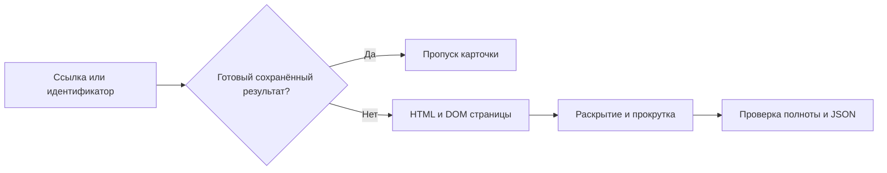

# 🗺️ Yandex Maps Reviews

Сбор текстов отзывов и индивидуальных оценок из публичных карточек организаций на Яндекс Картах. Программа открывает страницы в Chromium, читает HTML и DOM, раскрывает сокращённые тексты и сохраняет результаты в JSON.

Для запуска нужны **Python 3.11 или новее**, интернет и Chromium, устанавливаемый средствами Playwright. Проверенная конфигурация: Windows, Python 3.11.7, Playwright 1.52.0, Chromium 138. Работа в Linux и macOS отдельно не проверялась.

## ✨ Что умеет сборщик

- Принимает ссылку на организацию или её числовой идентификатор; поддерживает несколько карточек за запуск.
- Сохраняет текст, оценку от 1 до 5, автора, публичную ссылку на профиль и дату каждого отзыва.
- Получает название, адрес, координаты, категории, общую оценку и счётчики организации, когда эти сведения присутствуют на странице.
- Использует полные тексты из встроенного HTML, чтобы не раскрывать уже полученные отзывы повторно.
- Сохраняет промежуточные результаты и использует их при следующем запуске.
- Различает полный сбор, достижение лимита, неполные поля и расхождение со счётчиком сайта.
- Делает ограниченное число повторов после HTTP 429 с увеличением паузы и учётом `Retry-After`.

**Ключи доступа и API Яндекс Карт не требуются.** Сборщик не вызывает отдельные служебные методы получения отзывов и не читает содержимое их ответов. Данные извлекаются из HTML публичной страницы и её DOM. Сам сайт при работе в браузере может выполнять собственные сетевые запросы; их коды и заголовки учитываются для обнаружения ограничений доступа.

## 🚀 Быстрый запуск

Скачайте или скопируйте репозиторий и откройте терминал в его папке. Команды ниже создают отдельное окружение, устанавливают зависимость и браузер.

### Windows · PowerShell

```powershell
# Создаём окружение; требуется установленный Python 3.11 или новее.
python -m venv .venv
# Устанавливаем зависимость в это окружение.
.\.venv\Scripts\python.exe -m pip install -r requirements.txt
# Устанавливаем Chromium, совместимый с Playwright.
.\.venv\Scripts\python.exe -m playwright install chromium
# Собираем до 100 отзывов указанной организации.
.\.venv\Scripts\python.exe collect_yandex.py 44307431220 --limit 100
```

### Linux и macOS

```bash
# Создаём отдельное окружение Python.
python3 -m venv .venv
# Устанавливаем зависимость в это окружение.
.venv/bin/python -m pip install -r requirements.txt
# Устанавливаем совместимый Chromium.
.venv/bin/python -m playwright install chromium
# Собираем до 100 отзывов указанной организации.
.venv/bin/python collect_yandex.py 44307431220 --limit 100
```

В Linux при сообщении о недостающих системных библиотеках выполните `python -m playwright install-deps chromium` тем Python, которым установлен Playwright. Установка системных библиотек может потребовать административных прав.

После запуска в папке `review_results/` появится файл `<идентификатор организации>.json`. В терминале отображаются открытие карточки, паузы и итоговые счётчики. Обработка завершается без отдельного окна браузера.

## 🔗 Как передать организации

Можно использовать обычную ссылку из адресной строки Яндекс Карт. Параметры после `?` не требуются. Ссылку заключайте в кавычки.

```powershell
# Передаём ссылку на страницу отзывов и повышаем лимит до 150.
.\.venv\Scripts\python.exe collect_yandex.py "https://yandex.ru/maps/org/-/44307431220/reviews/" --limit 150
# Последовательно собираем две карточки с паузой 30 секунд между ними.
.\.venv\Scripts\python.exe collect_yandex.py 44307431220 1245233699 --limit 150 --pause 30
# Обновляем ранее завершённый результат, повторно открывая страницу.
.\.venv\Scripts\python.exe collect_yandex.py 44307431220 --limit 150 --refresh
# Сохраняем результаты в выбранную папку.
.\.venv\Scripts\python.exe collect_yandex.py 44307431220 --output "my_reviews"
```

Принимаются HTTPS-ссылки на карточки организаций с доменами `yandex.ru` и `yandex.com`, а также числовые идентификаторы. Сокращённую ссылку сначала откройте в обычном браузере и скопируйте полный адрес. Поиск организаций по названию, категориям или территории в текущую версию не входит.

## ⚙️ Параметры

| Параметр | По умолчанию | Назначение |
|---|---|---|
| `urls` | Обязателен | Одна или несколько ссылок либо числовых идентификаторов |
| `--limit` | `100` | Максимум отзывов на организацию; от 1 до 300 |
| `--output` | `review_results` | Папка JSON-файлов; одновременно используется для возобновления |
| `--pause` | `20` | Пауза между открываемыми карточками, секунды; не менее 10 |
| `--scroll-pause` | `5` | Пауза после прокрутки, секунды; не менее 3 |
| `--429-retries` | `3` | Число повторов после исходной попытки с HTTP 429; от 0 до 3 |
| `--refresh` | Выключен | Повторно открыть карточки с готовым сохранённым результатом |
| `--executable` | Не задан | Путь к исполняемому файлу установленного Chromium |
| `--help` | — | Показать справку |

`--limit` задаёт объём сбора, а не ускорение обработки. Например, статус `capped` при лимите 100 означает получение заданных 100 отзывов; он не означает, что у организации всего 100 отзывов. Для карточек с более чем 300 отзывами эта версия не предназначена для полного сбора.

## 🔄 Загрузка и возобновление



Программа сначала проверяет JSON: организацию, версию формата, уникальность ключей, наличие текста и даты, целую оценку 1–5 и отсутствие сокращённых текстов. Результат `complete` используется повторно, если число записей соответствует сохранённому счётчику. Результат `capped` используется, если записей достаточно для нового лимита. Если все карточки уже готовы, браузер вообще не запускается.

При незавершённом сборе повторите ту же команду с той же папкой `--output`. Страница откроется заново, а сохранённые полные тексты помогут избежать повторного раскрытия. Это повторный проход по странице, а не продолжение с конкретной позиции прокрутки. При успешном завершении в снимке остаются отзывы, подтверждённые текущим DOM. При остановке сохраняется накопленный прогресс, который может включать записи предыдущей попытки.

`--refresh` повторно посещает карточку, сохраняя возможность использовать уже полученные тексты. Для полностью нового снимка укажите другую папку `--output`. Файл кэша является снимком: без обновления новые отзывы на сайте не проверяются. Повреждённый JSON или несовместимый формат нужно сохранить отдельно и повторить сбор в новой папке.

Запись выполняется через временный файл `.json.tmp` с последующей заменой итогового JSON. Не запускайте два процесса с одинаковой папкой результатов для одной организации: их записи будут конфликтовать.

## 📦 Что находится в JSON

| Поле | Содержание |
|---|---|
| `schema_version` | Версия формата; сейчас `1` |
| `organization_id`, `url`, `final_url` | Организация, исходный и конечный адрес страницы |
| `collected_at` | Время начала последней попытки в UTC |
| `status`, `limit` | Состояние обработки и заданный лимит |
| `company` | Название, адрес, координаты, категории, общая оценка и счётчики |
| `reviews` | Отзывы: `id`, `author`, `author_url`, `date`, `text`, `rating`, `text_truncated` |
| `source_review_id` внутри отзыва | Исходный идентификатор из встроенного HTML, если доступен |
| `valid_reviews`, `truncated_count`, `invalid_rating_count` | Число полных записей, сокращённых текстов и нераспознанных оценок |
| `observed_this_run`, `observed_in_dom` | Число уникальных записей, найденных при последней попытке в HTML/DOM и отдельно в DOM |
| `elapsed_seconds`, `scrolls`, `expanded_texts` | Длительность последней попытки, число прокруток и раскрытых текстов |
| `network`, `attempts` | Счётчики загрузки, HTTP-ошибки и журнал попыток |

Координаты `company.coordinates_lon_lat` записываются как **[долгота, широта]**. Счётчик `ratings_count` включает оценки без текстового отзыва; его нельзя использовать как ожидаемое число записей `reviews`.

`reviews[].rating` — оценка конкретного отзыва. Общая оценка организации находится в `company.rating`. Если оценка отзыва не распознана, сохраняется `null`, без подстановки общего рейтинга.

`reviews[].id` — локальный SHA-256 ключ из организации, автора и даты; при отсутствии автора или даты дополнительно используется текст. Он нужен для объединения записей, а не является исходным идентификатором Яндекса. Изменение даты или профиля может изменить этот ключ. Даты сохраняются в виде, полученном со страницы, без дополнительного пересчёта часового пояса. Недоступные сведения об организации могут отсутствовать или иметь значение `null`.

## 🚦 Статусы завершения

| Статус | Значение и следующее действие |
|---|---|
| `complete` | Все подтверждённые отзывы имеют обязательные поля, число совпало со счётчиком; также возможна карточка с нулём отзывов |
| `capped` | Получен заданный лимит полных отзывов; для большего объёма повысьте `--limit` |
| `count_mismatch` | Число найденных записей превышает счётчик страницы; записи сохранены, расхождение требует проверки |
| `incomplete_fields` | Достигнут счётчик или лимит, но у части записей нет полного текста, даты или оценки |
| `rate_limited` | Сайт вернул HTTP 429; после исчерпания повторов очередь остановлена |
| `captcha`, `access_denied` | Проверка пользователя или отказ в доступе; очередь остановлена |
| `stalled` | Три прокрутки подряд не дали новых карточек |
| `time_budget`, `scroll_budget` | Превышен бюджет попытки: проверка 240 секунд в цикле либо 25 проходов |
| `timeout`, `server_error`, `error` | Ошибка ожидания, повторяющиеся HTTP 502/503/504 либо другая ошибка; подробности доступны в JSON |
| `running` | Промежуточный файл; обработка ещё идёт или была прервана |

В терминале также встречается `cache_hit`: готовый файл использован без посещения сайта. Это событие, а не новый статус внутри сохранённого JSON. Для автоматической обработки ориентируйтесь на поле `status` в файле, а не только на код завершения процесса.

## ⏱️ Паузы и ограничения сайта

После HTTP 429 повторное открытие выполняется через 60, 120 и 240 секунд. При наличии `Retry-After` используется большая из этих задержек. Если сервер требует ждать более 900 секунд, программа сохраняет результат и завершает очередь, не отправляя преждевременный повторный запрос. CAPTCHA автоматически не решается.

После таймаута открытия страницы и HTTP 502/503/504 допускаются ещё две попытки с паузами 30 и 60 секунд. Одна вкладка и одна сессия используются для всей очереди. User-Agent содержит фактическую версию Chromium с обозначением Chrome. Изображения, шрифты и видео не загружаются; сценарии, стили и текстовые ресурсы страницы остаются доступны.

Паузы уменьшают частоту обращений, но не гарантируют снятия ограничения или отсутствия блокировки IP. Условия доступа могут меняться; успешная загрузка нескольких карточек не подтверждает устойчивость массового сбора. Бюджет 240 секунд проверяется внутри цикла прокрутки: ожидание открытия, отдельные действия и повторы могут увеличить общее время. `elapsed_seconds` относится к последней попытке и не включает паузы между попытками и организациями.

## 🧪 Проверка работоспособности

После установки браузера выполните:

```powershell
# Проверяем сборщик на вымышленных HTML-страницах без запросов к Яндекс Картам.
.\.venv\Scripts\python.exe test_reviews.py -v
# Показываем параметры запуска без открытия браузера.
.\.venv\Scripts\python.exe collect_yandex.py --help
```

Шесть автономных проверок охватывают объединение HTML и DOM, индивидуальные оценки, полные тексты, 429 и CAPTCHA, нулевое число отзывов, расхождение счётчиков, проверку кэша и отсутствие запуска браузера при готовых файлах.

В предварительных проверках реальных карточек получены 132 полных отзыва при счётчике 132; у другой карточки обнаружены 162 записи при счётчике 161, с явным статусом `count_mismatch`. Время соответствующих попыток — 30,69 и 20,86 секунды, без запуска браузера и межкарточных пауз. Методика, повторная проверка текущего кода и ограничения измерений приведены в [отчёте производительности](docs/PERFORMANCE.md).

## 🧩 Файлы и изменение селекторов

| Файл | Назначение |
|---|---|
| `collect_yandex.py` | Запуск, браузерный сбор, прокрутка, объединение и сохранение |
| `extract_saved_html.py` | Извлечение первой порции отзывов из HTML средствами стандартной библиотеки |
| `test_reviews.py` | Автономные проверки на вымышленных данных |
| `requirements.txt` | Фиксированная зависимость Playwright |
| `docs/PERFORMANCE.md` | Результаты проверки корректности и производительности |

Селекторы DOM находятся в `CARDS`, `EXTRACT` и двух сценариях раскрытия и прокрутки внутри `collect_yandex.py`. Чтение встроенного состояния `script.state-view` находится в `extract_saved_html.py`. После изменения разметки сайта обновите соответствующий блок, выполните автономные проверки и проверьте одну карточку с полным текстом и индивидуальными оценками.

Вспомогательный модуль можно вызвать отдельно для сохранённой HTML-страницы:

```powershell
# Извлекаем только встроенную порцию отзывов из локального HTML, без сети.
.\.venv\Scripts\python.exe extract_saved_html.py page.html 44307431220 --output first_batch.json
```

HTML может содержать только первую порцию отзывов. Этот вызов не прокручивает страницу и не загружает продолжение.

## 📄 Авторство и лицензия

Автор: **Alexandre**. Код распространяется по лицензии [MIT](LICENSE).

При проверке актуальной разметки и подходов к раскрытию отзывов изучались [yandex-reviews-to-md](https://github.com/baslie/yandex-reviews-to-md) и [ymrp](https://github.com/MironBerch/ymrp). Репозиторий содержит самостоятельную реализацию сбора и сохранения.
