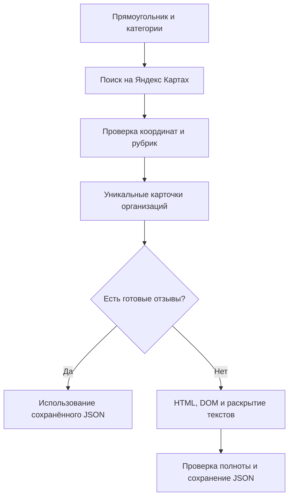

# 🗺️ Yandex Maps Reviews

Поиск организаций по выбранной территории и категориям, затем сбор текстов отзывов и индивидуальных оценок с Яндекс Карт. Программа открывает публичные страницы в Chromium, читает HTML и DOM, проверяет координаты и рубрики, раскрывает сокращённые тексты и сохраняет результаты в JSON.

Для запуска нужны **Python 3.11 или новее**, интернет и Chromium, устанавливаемый средствами Playwright. Проверенная конфигурация: Windows, Python 3.11.7, Playwright 1.52.0, Chromium 138. Работа в Linux и macOS отдельно не проверялась.

## ✨ Что умеет сборщик

- Принимает ссылку на организацию или её числовой идентификатор; поддерживает несколько карточек за запуск.
- Самостоятельно находит ссылки по выбранной территории и категориям; готовые идентификаторы вручную вводить не требуется.
- Принимает прямоугольник, нарисованный полигон или границу GeoJSON, включая отдельные контуры и отверстия.
- Предлагает поиск города в локальном каталоге границ, 1589 опубликованных рубрик, 20 готовых поисковых настроек и собственные запросы.
- По умолчанию собирает все доступные текстовые отзывы; необязательный лимит выбирает самые свежие отзывы каждой организации.
- Сохраняет текст, оценку от 1 до 5, автора, публичную ссылку на профиль и дату каждого отзыва.
- Получает название, адрес, координаты, категории, общую оценку и счётчики организации, когда эти сведения присутствуют на странице.
- Использует полные тексты из встроенного HTML, чтобы не раскрывать уже полученные отзывы повторно.
- Сохраняет промежуточные результаты и использует их при следующем запуске.
- Различает полный сбор, достижение лимита, неполные поля и расхождение со счётчиком сайта.
- Делает ограниченное число повторов после HTTP 429 с увеличением паузы и учётом `Retry-After`.

**Ключи доступа и API Яндекс Карт не требуются.** Сборщик не вызывает отдельные служебные методы получения отзывов и не читает содержимое их ответов. Данные извлекаются из HTML публичной страницы и её DOM. Сам сайт при работе в браузере может выполнять собственные сетевые запросы; их коды и заголовки учитываются для обнаружения ограничений доступа.

## 🐍 Использование как пакета Python

После клонирования или распаковки репозитория выполните в его папке:

```bash
# Устанавливаем пакет в активное окружение Python.
python -m pip install .
# Устанавливаем браузер для сбора публичных страниц.
python -m playwright install chromium
# При необходимости добавляем GeoPandas для пространственной таблицы.
python -m pip install ".[geo]"
```

Для разработки вместо первой команды можно использовать `python -m pip install -e .`. Установка из папки работает до публикации репозитория. В Jupyter или Colab пакет устанавливается в окружение текущего ядра; например, `%pip install /content/yandex-maps-reviews`, затем `!python -m playwright install chromium`. Путь `/content/yandex-maps-reviews` предполагает, что репозиторий уже находится в этой папке.

```python
# Импортируем единую функцию поиска организаций и сбора отзывов.
from yandex_maps_reviews import collect_area

# Выбираем город из локального каталога и категории организаций.
result = collect_area(
    # Название разрешается по локальному каталогу границ.
    city="Москва",
    # Ищем кафе и жилые комплексы.
    tags=["cafe", "residential"],
    # Для первой проверки ограничиваем число организаций на каждый запрос.
    max_orgs=3,
    # Собираем до 50 самых свежих отзывов каждой организации.
    max_reviews=50,
    # Сохраняем снимки и прогресс для повторного запуска.
    output="results_moscow",
)
# Получаем одну строку на организацию, включая общую оценку и статус сбора.
organizations = result.organizations
# Получаем одну строку на сохранённый отзыв, включая звёзды и признаки подтверждения.
reviews = result.reviews
# Выбираем подтверждённые полные тексты для дальнейшего анализа.
confirmed = result.confirmed_reviews()
# При установленных пространственных зависимостях получаем точки организаций в WGS84.
geo = result.to_geopandas()
# Проверяем состояния запросов и диагностику полноты.
diagnostics = result.metadata
```

`max_reviews=None` по умолчанию означает все доступные отзывы. `max_orgs=20` по умолчанию ограничивает видимую выборку организаций **на каждый выбранный запрос**; допустимый диапазон — 1–100. Достижение лимита и завершение видимой выдачи не означают полный охват города.

Вместо `city` передайте **ровно один** из параметров `bbox`, `geometry` или `config`:

```python
# Передаём прямоугольник из обработчика интерактивной карты: запад, юг, восток, север.
result = collect_area(bbox=[84.965, 56.455, 85.005, 56.485], tags=["cafe", "school"], output="results_rectangle")
# Передаём файл с точной границей; также допустим словарь GeoJSON.
result = collect_area(geometry="district.geojson", tags=["residential"], output="results_polygon")
# Используем экспорт карты со всеми выбранными категориями и запросами.
result = collect_area(config="area.json", max_reviews=50, output="results_from_map")
```

Для `bbox` используйте долготу и широту в градусах WGS84. Карты, возвращающие пары «широта, долгота», требуют перестановки координат. GeoJSON проверяется по тем же правилам, что и при запуске из терминала. Названия рубрик иногда повторяются в разных разделах документации; их локальные ключи различаются. В каталоге пока есть Москва и Санкт-Петербург; границы архивные, их даты доступны через `list_cities()` и `result.metadata["city_boundary"]`. Остальные территории передавайте своим GeoJSON или прямоугольником. Экспорт `area.json` сохраняет категории и свободные запросы; явно переданные `tags` или `queries` заменяют соответствующий выбор конфига.

```python
# Узнаём доступные категории и города без браузера и сети.
from yandex_maps_reviews import list_categories, list_cities, load_results
# Каждый ключ категории связан с названием, поисковой фразой и проверяемыми рубриками.
categories = list_categories()
# Каждый город содержит источник и дату границы.
cities = list_cities()
# Повторно читаем ранее сохранённый результат без сбора.
result = load_results("results_moscow", max_reviews=50)
# При необходимости выполняем только поиск организаций, без чтения старых отзывных файлов.
result = collect_area(city="Москва", tags=["residential"], with_reviews=False, output="organizations_only")
```

| Часть результата | Содержимое |
|---|---|
| `result.organizations` | Pandas DataFrame: `organization_id`, `name`, `address`, `longitude`, `latitude`, `rubrics`, `found_by`, общая `rating`, `ratings_count`, `reviews_count`, `review_status`, `reviews_ready`, счётчики сохранённых и подтверждённых записей |
| `result.reviews` | Pandas DataFrame: `organization_id`, `id`, `text`, звёзды `rating`, дата `date` в UTC, исходная `date_raw`, автор, происхождение `observation`, `full_text_confirmed`, `confirmed`, время и статус снимка |
| `result.confirmed_reviews()` | Независимая таблица только с подтверждённым полным текстом, датой и звёздами 1–5. Старые строки без признаков подтверждения исключаются |
| `result.to_geopandas()` | GeoDataFrame организаций с геометрией Point в `EPSG:4326`; неизвестные координаты дают отсутствующую геометрию. Таблица отзывов остаётся отдельной |
| `result.metadata` | Границы, охват, состояния поисков, диагностика каждой карточки в `review_runs`, журнал очереди `review_jobs`, путь к файлам; после сбора также `run_status`, `returncode`, `city_boundary` |

Таблицы связаны строковым `organization_id`: отзывы можно объединить с адресами или оценками через `merge`. Общая оценка организации читается из её карточки и не заменяется средним звёзд в частичной выборке. Неизвестные оценки и счётчики остаются пропусками. При пустом поиске таблицы сохраняют тот же набор столбцов.

При `stalled`, CAPTCHA или другом явно записанном частичном исходе функция возвращает доступные строки с `run_status="partial"`. Она не скрывает статус карточек и прежние неподтверждённые записи. Ошибка параметров, занятая папка или сбой процесса вызывают исключение; уже записанные файлы остаются на диске. Старые результаты не выдаются за новый успешный запуск после ошибки. Для разных заданий выбирайте разные папки; для продолжения передайте ту же папку и те же параметры. `load_results()` не посещает сайт и читает только выбранный вариант лимита.

Существующий сборщик запускается отдельным процессом того же Python, поэтому синхронный Playwright работает также из Jupyter и Colab. Организации обрабатываются последовательно, паузы и правила остановки сохраняются. Значения `pause=20`, `scroll_pause=5`, `rate_retries=3` соответствуют сценарию терминала; `refresh=True` повторно посещает завершённые карточки, `executable` задаёт путь к установленному Chromium. Для обхода ограничений доступа эти параметры не используются.

## 🚀 Быстрый запуск

Скачайте или скопируйте репозиторий и откройте терминал в его папке. Команды ниже создают отдельное окружение, устанавливают зависимости и браузер.

### Windows · PowerShell

```powershell
# Создаём окружение; требуется установленный Python 3.11 или новее.
python -m venv .venv
# Устанавливаем зависимость в это окружение.
.\.venv\Scripts\python.exe -m pip install -r requirements.txt
# Устанавливаем Chromium, совместимый с Playwright.
.\.venv\Scripts\python.exe -m playwright install chromium
# Собираем все доступные отзывы указанной организации.
.\.venv\Scripts\python.exe collect_yandex.py 44307431220
```

### Linux и macOS

```bash
# Создаём отдельное окружение Python.
python3 -m venv .venv
# Устанавливаем зависимость в это окружение.
.venv/bin/python -m pip install -r requirements.txt
# Устанавливаем совместимый Chromium.
.venv/bin/python -m playwright install chromium
# Собираем все доступные отзывы указанной организации.
.venv/bin/python collect_yandex.py 44307431220
```

В Linux при сообщении о недостающих системных библиотеках выполните `python -m playwright install-deps chromium` тем Python, которым установлен Playwright. Установка системных библиотек может потребовать административных прав.

После полного сбора в папке `review_results/` появится файл `<идентификатор организации>.json`. При заданном лимите создаётся отдельный файл, например `<идентификатор>.limit50.json`: ограниченная выборка не затирает полный снимок. В терминале отображаются открытие карточки, паузы и итоговые счётчики. Обработка завершается без отдельного окна браузера.

## 📍 Поиск по территории и категориям

После установки зависимостей откройте терминал в папке репозитория и запустите страницу выбора территории:

```powershell
# Отдаём только локальные файлы интерфейса; этот сервер не собирает отзывы.
.\.venv\Scripts\python.exe -m http.server 8000 --bind 127.0.0.1
```

Откройте [карту выбора территории](http://127.0.0.1:8000/select_area.html). Выберите область одним из четырёх способов:

- **Прямоугольник:** приблизьте участок, нажмите «Выделить прямоугольник» и протяните рамку.
- **Полигон:** нажмите «Нарисовать полигон», отметьте вершины и нажмите первую вершину для завершения. Esc отменяет рисование, сохраняя прежнюю выбранную область.
- **Файл:** загрузите GeoJSON с `Polygon`, `MultiPolygon`, объектом `Feature` или непустой полигональной `FeatureCollection`. Все объекты коллекции образуют одну территорию; перекрывающиеся части объединяются.
- **Город:** введите название в поле локального каталога и нажмите найденный вариант. Карта покажет его контур.

Затем выберите категории и при необходимости добавьте свои запросы. Нажмите **«Скачать area.json»** и поместите файл в папку репозитория. Для отображения карты нужен интернет: Leaflet загружается с CDN, подложка — обычные изображения OSM. Границы городов читаются из локальных файлов; организации из OSM не извлекаются.

В другом терминале той же папки выполните:

```powershell
# Находим организации и собираем все доступные отзывы каждой.
.\.venv\Scripts\python.exe discover_yandex.py --config area.json --with-reviews
# Для первого запуска можно задать небольшой объём: 3 организации на категорию и 20 отзывов на каждую.
.\.venv\Scripts\python.exe discover_yandex.py --config area.json --max-orgs 3 --with-reviews --review-limit 20
```

В Linux и macOS используйте `.venv/bin/python` вместо `.\.venv\Scripts\python.exe`. Статический сервер нужен только для выбора территории; после сохранения конфига его можно остановить клавишами Ctrl+C.

Карту можно пропустить и передать границы напрямую. Порядок — **запад, юг, восток, север**, то есть две пары **долгота, широта**:

```powershell
# Ищем кафе и школы в небольшом прямоугольнике Томска, пока без отзывов.
.\.venv\Scripts\python.exe discover_yandex.py --bbox 84.965 56.455 85.005 56.485 --categories cafe school --max-orgs 5
# Выводим все готовые категории и рубрики без запуска браузера.
.\.venv\Scripts\python.exe discover_yandex.py --list-categories
# Ищем другую категорию явным свободным запросом.
.\.venv\Scripts\python.exe discover_yandex.py --bbox 84.965 56.455 85.005 56.485 --query "дом культуры"
```

`area.example.json` содержит примерные границы прямоугольника и категории. В конфиге `bbox` обозначает рамку поиска, `categories` — ключи готовых категорий, `queries` — свободные запросы. Для полигона добавляется `geometry` с точным GeoJSON; необязательный `area_source` хранит название, источник и дату снимка. Геометрия не заменяется рамкой при проверке организаций. Если `geometry` задана без `bbox`, рамка вычисляется автоматически; если заданы оба поля, они должны совпадать.

Локальный GeoJSON можно передать без карты:

```powershell
# Используем точную границу из своего файла и собираем отзывы найденных кафе.
.\.venv\Scripts\python.exe discover_yandex.py --geometry city.geojson --categories cafe --with-reviews
```

Координаты — **WGS84, долгота и широта**, без высоты и поля `crs`. Метрические координаты нужно предварительно преобразовать. Файл конфига или GeoJSON ограничен 10 МБ; одна геометрия — 200 000 вершин. Сборщик отклоняет незамкнутые контуры, самопересечения, неверные отверстия, нулевую площадь и некорректные числа до открытия Яндекса. Контуры не упрощаются и не исправляются автоматически. Переход через 180-й меридиан не поддерживается. Проверка файла в интерфейсе предварительная; полную проверку топологии выполняет Python при запуске.

Поиск и отзывы выполняются в одной вкладке и одной браузерной сессии. Перед переходом к следующей поисковой странице или карточке выдерживается пауза. Повторный запуск проверяет совместимость поисковых снимков и отзывов; если всё готово, браузер не запускается.

## 🏙️ Локальный каталог границ

В комплекте находятся **Москва и Санкт-Петербург**, административные границы из файловой выгрузки OSM [missinglink/osm-boundaries](https://github.com/missinglink/osm-boundaries). Это **архивный снимок за 8 декабря 2016 года**, а не подтверждённые актуальные границы. Дата показывается до выбора города и сохраняется в конфиге. Для текущего исследования проверьте границу и при необходимости загрузите более свежий GeoJSON. Москва здесь означает территорию города федерального значения, включая отдельные контуры, а не только участок внутри МКАД.

Поиск города работает по названию и вариантам написания из `boundaries/catalog.json`, без Nominatim, Overpass или другого геокодирующего API. Он ограничен содержимым каталога. Файлы контуров загружаются только после выбора города; все границы сразу не читаются.

Чтобы добавить город, поместите его полигональный GeoJSON в `boundaries/` и добавьте запись в `cities` файла `boundaries/catalog.json`. Укажите уникальный `id`, `name`, понятный `label`, список `aliases`, относительный `file`, дату снимка `snapshot` и ссылку `source_url`. Для пути используйте латинские строчные буквы, цифры и дефисы: например, `boundaries/tomsk.geojson`. Проверьте файл командой `python test_geometry.py -v`. После перезагрузки страницы новая запись появится в поиске. Нужную границу также можно загрузить через интерфейс, не изменяя каталог.

Данные границ имеют отдельную лицензию ODbL 1.0 и указание источника © OpenStreetMap contributors; подробности — в [описании каталога](boundaries/README.md).

## 🏷️ Категории и полный опубликованный справочник

Источник — [рубрикатор мест и организаций Яндекса](https://yandex.ru/support/nmaps/ru/app_poi). В `categories.json` включён снимок от **3 октября 2026 года**: **1589 опубликованных рубрик** и **20 прежних готовых настроек**, всего 1609 записей. Из опубликованных рубрик 1542 относятся к основной части справочника, ещё 47 — к отдельному разделу Яндекс Бизнеса. Источник, дата и SHA-256 документа указаны в JSON. Каталог читается локально; дополнительные запросы для выбора категории не выполняются.

Выбирайте категорию по короткому ключу (`cafe`, `school`, `residential`), русскому названию или ключу опубликованной рубрики (`rubric_13_3_7` — «Жилой комплекс»). `business_1` означает «Комплекс апартаментов». Номера разделов документации используются только для ключей локального снимка и **не являются идентификаторами поисковых фильтров Яндекса**. Прежние ключи сохраняются; при совпадении русского названия предпочтение отдаётся прежней готовой настройке.

На карте есть поиск по названию и тематической группе. Он не снимает флажки у скрытых выбранных строк. В Python весь список доступен через `list_categories()`, из терминала — через `--list-categories`.

Поддержка записи означает поиск по её фразе `query`, затем проверку фактических рубрик карточки по `rubrics`. Регистр, пробелы и различие е/ё игнорируются. Это не документированный интерфейс фильтров Яндекса и не гарантия обнаружения всех объектов. Название в документации может отличаться от названия рубрики в выдаче; такие кандидаты остаются в диагностике как `rubric_mismatch`. Для свободного `queries=["дом культуры"]` проверяются карточка и территория, а заранее заданная рубрика не проверяется.

Все 1609 настроек проверены на целостность справочника. Живые поисковые проверки проводились для кафе и общеобразовательных школ; все остальные рубрики не проверялись массовыми сетевыми запросами. Объекты без координат или карточки организации, включая часть записей раздела Яндекс Бизнеса, не попадают в выборку организаций. Раздел «Виды деятельности с онлайн-записью» имеет отдельное назначение и не заменяет этот справочник.

**Жилая недвижимость:** `residential` — жилые комплексы и новостройки, `cottage` — коттеджные посёлки, `business_1` — комплексы апартаментов. Обычное жилое здание по адресу и карточка организации с отзывами — разные объекты. Сборщик не обещает получение всех жилых домов или отзывов каждого адреса. Это следует из различия [типов зданий](https://yandex.ru/support/nmaps/ru/cat_bld_rul2) и [рубрик мест и организаций](https://yandex.ru/support/nmaps/ru/app_poi).

<details>
<summary>Все доступные категории: 1589 опубликованных рубрик и 20 готовых настроек</summary>

### Готовые поисковые настройки

| Ключ | Название |
|---|---|
| `cafe` | Кафе |
| `restaurant` | Рестораны |
| `coffee` | Кофейни |
| `school` | Школы |
| `kindergarten` | Детские сады |
| `university` | Вузы |
| `pharmacy` | Аптеки |
| `clinic` | Медицинские центры |
| `dentist` | Стоматологии |
| `veterinary` | Ветеринарные клиники |
| `grocery` | Продуктовые магазины |
| `supermarket` | Супермаркеты |
| `hotel` | Гостиницы |
| `gym` | Фитнес-клубы |
| `car_repair` | Автосервисы |
| `park` | Парки |
| `museum` | Музеи |
| `library` | Библиотеки |
| `residential` | Жилые комплексы |
| `cottage` | Коттеджные посёлки |

### Культура и достопримечательности

| Ключ | Название |
|---|---|
| `rubric_1_1_1` | Декоративный объект |
| `rubric_1_1_2` | Достопримечательность |
| `rubric_1_1_3` | Место событий, локальный ориентир |
| `rubric_1_1_4` | Природа |
| `rubric_1_1_5` | Стрит-арт |
| `rubric_1_1_6` | Питьевые галереи и источники |
| `rubric_1_1_7` | Информационный стенд, доска почета |
| `rubric_1_1_8` | Памятник архитектуры |
| `rubric_1_1_9` | Археологический памятник |
| `rubric_1_2_1` | Изготовление витражей |
| `rubric_1_2_2` | Художественный салон |
| `rubric_1_2_3` | Багетные изделия |
| `rubric_1_2_4` | Иконописная мастерская |
| `rubric_1_2_5` | Художественная мастерская |
| `rubric_1_2_6` | Художественная галерея |
| `rubric_1_2_7` | Гончарная мастерская |
| `rubric_1_2_8` | Кузница |
| `rubric_1_3_1` | Архив |
| `rubric_1_3_2` | Библиотека |
| `rubric_1_3_3` | Буккроссинг |
| `rubric_1_4_1` | Оркестр |
| `rubric_1_4_2` | Хор, хоровая студия |
| `rubric_1_4_3` | Музыкальное образование |
| `rubric_1_4_4` | Школа танцев |
| `rubric_1_4_5` | Хореографическое училище |
| `rubric_1_4_6` | Творческий коллектив |
| `rubric_1_4_7` | Концертный зал |
| `rubric_1_4_8` | Филармония |
| `rubric_1_4_9` | Музыкальный магазин |
| `rubric_1_4_10` | Музыкальный клуб |
| `rubric_1_4_11` | Сцена, амфитеатр |
| `rubric_1_5_1` | Театр |
| `rubric_1_5_2` | Театрально-концертная касса |
| `rubric_1_6_1` | Въездной знак |
| `rubric_1_6_2` | Жанровая скульптура |
| `rubric_1_6_3` | Мемориальная доска, закладной камень |
| `rubric_1_6_4` | Могилы известных людей |
| `rubric_1_6_5` | Памятник технике |
| `rubric_1_6_6` | Памятник, мемориал |
| `rubric_1_7_1` | Планетарий |
| `rubric_1_7_2` | Выставочный центр |
| `rubric_1_7_3` | Музей |
| `rubric_1_7_4` | Школьный музей |
| `rubric_1_8` | Смотровая площадка |
| `rubric_1_9_1` | Дом культуры |
| `rubric_1_9_2` | Культурный центр |
| `rubric_1_10_1` | Кинопрокатная компания |
| `rubric_1_10_2` | Киностудия |
| `rubric_1_10_3` | Кинотеатр |
| `rubric_1_11_1` | Цирк |

### Медицина и фармацевтика

| Ключ | Название |
|---|---|
| `rubric_2_1_1` | Амбулатория, здравпункт, медпункт |
| `rubric_2_1_2` | Больница для взрослых |
| `rubric_2_1_3` | Госпиталь |
| `rubric_2_1_4` | Детская больница |
| `rubric_2_1_5` | Детская поликлиника |
| `rubric_2_1_6` | Диспансер |
| `rubric_2_1_7` | Женская консультация |
| `rubric_2_1_8` | Медсанчасть |
| `rubric_2_1_9` | Морг |
| `rubric_2_1_10` | Поликлиника для взрослых |
| `rubric_2_1_11` | Родильный дом |
| `rubric_2_1_12` | Специализированная больница |
| `rubric_2_1_13` | Травмпункт |
| `rubric_2_1_14` | Станция переливания крови |
| `rubric_2_1_15` | Хоспис |
| `rubric_2_1_16` | Перинатальный центр |
| `rubric_2_1_17` | Медико-социальная экспертиза |
| `rubric_2_1_18` | Судебно-медицинская экспертиза |
| `rubric_2_1_19` | Психоневрологический интернат |
| `rubric_2_1_20` | Молочная кухня |
| `rubric_2_1_21` | Отделение больницы, госпиталя |
| `rubric_2_2_1` | Аптека |
| `rubric_2_2_2` | Фитопродукция, БАДы |
| `rubric_2_2_3` | Фармацевтическая компания |
| `rubric_2_2_4` | Лекарства оптом |
| `rubric_2_3_1` | Диагностический центр |
| `rubric_2_3_2` | Медицинская помощь на дому |
| `rubric_2_3_3` | Медцентр, клиника |
| `rubric_2_3_4` | Наркологическая клиника |
| `rubric_2_3_5` | Перевозка больных |
| `rubric_2_3_6` | Медицинская реабилитация |
| `rubric_2_3_7` | Урологический центр |
| `rubric_2_3_8` | Центр профилактики СПИДа |
| `rubric_2_3_9` | Санитарно-эпидемиологическая служба |
| `rubric_2_3_10` | Центр планирования семьи |
| `rubric_2_3_11` | Гинекологическая клиника |
| `rubric_2_3_12` | Диализный центр |
| `rubric_2_3_13` | Психиатрическая клиника |
| `rubric_2_3_14` | Компьютерная томография |
| `rubric_2_3_15` | Магнитно-резонансная томография |
| `rubric_2_3_16` | Ультразвуковые исследования |
| `rubric_2_3_17` | Детская клиника |
| `rubric_2_3_18` | Взрослая травматология |
| `rubric_2_3_19` | Детская травматология |
| `rubric_2_3_20` | Дерматология |
| `rubric_2_4_1` | Зуботехническая лаборатория |
| `rubric_2_4_2` | Стоматологическая клиника |
| `rubric_2_4_3` | Стоматологическая поликлиника |
| `rubric_2_4_4` | Детская стоматология |
| `rubric_2_5_1` | Ветеринарная аптека |
| `rubric_2_5_2` | Ветеринарная клиника |
| `rubric_2_5_3` | Ветеринарная лаборатория |
| `rubric_2_5_4` | Ветеринарные препараты и оборудование |
| `rubric_2_6_1` | Контактные линзы |
| `rubric_2_6_2` | Салон оптики |
| `rubric_2_6_3` | Ремонт очков |
| `rubric_2_7_1` | Скорая медицинская помощь |
| `rubric_2_7_2` | Детская скорая помощь |
| `rubric_2_7_3` | Платная скорая медпомощь |
| `rubric_2_7_4` | Служба скорой медпомощи |
| `rubric_2_8_1` | Соляная пещера |
| `rubric_2_8_2` | Врач-психотерапевт |
| `rubric_2_8_3` | Коррекция зрения |
| `rubric_2_8_4` | Логопеды |
| `rubric_2_8_5` | Медицинская комиссия |
| `rubric_2_8_6` | Медицинская лаборатория |
| `rubric_2_8_7` | Нетрадиционная медицина |
| `rubric_2_8_8` | Пункт предрейсового осмотра |
| `rubric_2_8_9` | Частнопрактикующие врачи |
| `rubric_2_8_10` | Патронажная служба |
| `rubric_2_8_11` | Массажный салон |
| `rubric_2_8_12` | Медицинский туризм |
| `rubric_2_8_13` | Остеопатия |
| `rubric_2_8_14` | Психиатр |
| `rubric_2_8_15` | Подология |
| `rubric_2_8_16` | Пункт вакцинации |
| `rubric_2_8_17` | Лабомат |
| `rubric_2_8_18` | Нутрициология |
| `rubric_2_8_19` | Дефектологи |
| `rubric_2_8_20` | Пункт выдачи и приема анализов |
| `rubric_2_8_21` | Сестринские услуги |
| `rubric_2_8_22` | Клинические исследования |
| `rubric_2_9_1` | Магазин медицинских товаров |
| `rubric_2_9_2` | Ортопедический салон |
| `rubric_2_9_3` | Медицинская мебель |
| `rubric_2_9_4` | Фармацевтическое оборудование |
| `rubric_2_9_5` | Изготовление протезно-ортопедических изделий |
| `rubric_2_9_6` | Медицинские изделия и расходные материалы |
| `rubric_2_9_7` | Оснащение лабораторий |
| `rubric_2_9_8` | Ремонт медицинской техники |
| `rubric_2_9_9` | Слуховые аппараты |
| `rubric_2_9_10` | Товары для здоровья |
| `rubric_2_9_11` | Товары для инвалидов, средства реабилитации |
| `rubric_2_9_12` | Массажное оборудование |
| `rubric_2_9_13` | Медицинское оборудование, медтехника |
| `rubric_2_9_14` | Стоматологические материалы и оборудование |

### Образование и наука

| Ключ | Название |
|---|---|
| `rubric_3_1_1` | Духовное учебное заведение |
| `rubric_3_1_2` | Колледж |
| `rubric_3_1_3` | Театральное и цирковое образование |
| `rubric_3_1_4` | Техникум |
| `rubric_3_1_5` | Учебный комбинат |
| `rubric_3_1_6` | Училище |
| `rubric_3_1_7` | Цирковое образование |
| `rubric_3_2_1` | Бизнес-школа |
| `rubric_3_2_2` | Бухгалтерские курсы |
| `rubric_3_2_3` | Дополнительное образование |
| `rubric_3_2_4` | Компьютерные курсы |
| `rubric_3_2_5` | Курсы и мастер-классы |
| `rubric_3_2_6` | Курсы иностранных языков |
| `rubric_3_2_7` | Спортивная школа |
| `rubric_3_2_8` | Тренинги |
| `rubric_3_2_9` | Учебный центр |
| `rubric_3_2_10` | Фотошкола |
| `rubric_3_2_11` | Центр повышения квалификации |
| `rubric_3_2_12` | Школа для будущих мам |
| `rubric_3_2_13` | Школа искусств |
| `rubric_3_2_14` | Школа охраны |
| `rubric_3_2_15` | Киношкола |
| `rubric_3_2_16` | Обучение мастеров для салонов красоты |
| `rubric_3_2_17` | Центр профориентации |
| `rubric_3_2_18` | Обучение за рубежом |
| `rubric_3_2_19` | Научно-просветительский центр |
| `rubric_3_2_20` | Инфраструктура образования |
| `rubric_3_2_21` | Робототехника |
| `rubric_3_2_22` | Молодёжный центр |
| `rubric_3_2_23` | Курсы первой помощи |
| `rubric_3_3_1` | Конструкторское бюро |
| `rubric_3_3_2` | Научно-производственная организация |
| `rubric_3_3_3` | НИИ |
| `rubric_3_3_4` | Новые технологии |
| `rubric_3_3_5` | Обсерватория |
| `rubric_3_3_6` | Телескоп |
| `rubric_3_3_7` | Биотехнологии |
| `rubric_3_4_1` | ВУЗ |
| `rubric_3_4_2` | Консерватория |
| `rubric_3_5_1` | Военная, кадетская школа |
| `rubric_3_5_2` | Гимназия |
| `rubric_3_5_3` | Лицей |
| `rubric_3_5_4` | Начальная школа |
| `rubric_3_5_6` | Общеобразовательная школа |
| `rubric_3_5_7` | Частная школа |
| `rubric_3_5_8` | Школа санаторного типа |
| `rubric_3_5_9` | Школа-интернат |
| `rubric_3_6_1` | Детский сад, ясли |
| `rubric_3_6_2` | Клуб для детей и подростков |
| `rubric_3_6_3` | Центр развития ребенка |
| `rubric_3_6_4` | Детский коррекционный центр |

### Финансы

| Ключ | Название |
|---|---|
| `rubric_4_1_1` | Банк |
| `rubric_4_1_2` | Денежные переводы |
| `rubric_4_1_3` | Банковский платежный агент |
| `rubric_4_1_4` | Точка банковского обслуживания |
| `rubric_4_1_5` | Депозитарии и реестродержатели |
| `rubric_4_2_1` | Ломбард |
| `rubric_4_2_2` | Скупка золота и ювелирных изделий |
| `rubric_4_2_3` | Продажа золота |
| `rubric_4_3_1` | Банкомат |
| `rubric_4_4_1` | Обмен валюты |
| `rubric_4_5_1` | Платёжный терминал |
| `rubric_4_6_1` | Страхование автомобилей |
| `rubric_4_6_2` | Страховая компания |
| `rubric_4_6_3` | Общество взаимного страхования |
| `rubric_4_6_4` | Пункт выдачи страховых полисов |
| `rubric_4_6_5` | Страховой брокер |
| `rubric_4_6_6` | Фонд обязательного медицинского страхования |
| `rubric_4_7_1` | Микрофинансирование |
| `rubric_4_7_2` | Налоговые консультанты |
| `rubric_4_7_3` | Финансовый консалтинг |
| `rubric_4_7_4` | Аудиторская компания |
| `rubric_4_7_5` | Бухгалтерские услуги |
| `rubric_4_8_1` | Tax Free |
| `rubric_4_9_1` | Дилинговый центр 1600 - 1500 |
| `rubric_4_9_2` | Негосударственный пенсионный фонд |
| `rubric_4_9_3` | Брокерская компания |
| `rubric_4_9_4` | Инвестиционная компания |
| `rubric_4_9_5` | Коллекторское агентство |
| `rubric_4_9_6` | Лизинговая компания |
| `rubric_4_9_7` | Факторинговая компания |
| `rubric_4_9_8` | Электронная коммерция |
| `rubric_4_9_9` | Бюро кредитных историй |
| `rubric_4_9_10` | Кредитный брокер |
| `rubric_4_9_11` | Кредитный потребительский кооператив |
| `rubric_4_9_12` | Небанковская депозитно-кредитная организация |
| `rubric_4_9_13` | Небанковская кредитная организация |
| `rubric_4_9_14` | Платежная небанковская кредитная организация |
| `rubric_4_9_15` | Расчетная небанковская кредитная организация |
| `rubric_4_9_16` | Сельскохозяйственный кредитный потребительский кооператив |
| `rubric_4_9_17` | Центральный контрагент |
| `rubric_4_9_18` | Электронная платежная система |
| `rubric_4_9_19` | Картомат |
| `rubric_4_9_20` | Кредитомат |
| `rubric_4_9_21` | Криптомат |

### Торговля

| Ключ | Название |
|---|---|
| `rubric_5_1_1` | Булочная, пекарня |
| `rubric_5_1_2` | Диетические и диабетические продукты |
| `rubric_5_1_3` | Кондитерская |
| `rubric_5_1_4` | Продажа воды |
| `rubric_5_1_5` | Магазин мяса, колбас |
| `rubric_5_1_6` | Магазин кулинарии |
| `rubric_5_1_7` | Магазин продуктов |
| `rubric_5_1_8` | Магазин суши и роллов |
| `rubric_5_1_9` | Магазин чая и кофе |
| `rubric_5_1_10` | Мед и продукты пчеловодства |
| `rubric_5_1_11` | Молочный магазин |
| `rubric_5_1_12` | Мороженое |
| `rubric_5_1_13` | Овощной магазин |
| `rubric_5_1_14` | Рыба и морепродукты |
| `rubric_5_1_15` | Яйцо и мясо птицы |
| `rubric_5_1_16` | Продуктовый гипермаркет |
| `rubric_5_1_17` | Магазин кофе |
| `rubric_5_1_18` | Магазин азиатских продуктов |
| `rubric_5_1_19` | Пищевой лёд |
| `rubric_5_1_20` | Орехи, снеки, сухофрукты |
| `rubric_5_1_21` | Безалкогольные напитки |
| `rubric_5_1_22` | Ягоды |
| `rubric_5_1_23` | Магазин здорового питания |
| `rubric_5_2_1` | Торговый центр |
| `rubric_5_2_2` | Универмаг |
| `rubric_5_2_3` | Магазин беспошлинной торговли |
| `rubric_5_2_4` | Магазин смешанных товаров |
| `rubric_5_2_5` | Магазин фиксированной цены |
| `rubric_5_2_6` | Супермаркет |
| `rubric_5_2_7` | Магазин сниженных цен |
| `rubric_5_2_8` | Магазин индийских товаров |
| `rubric_5_3_1` | Магазин подарков и сувениров |
| `rubric_5_4_1` | Эксклюзивная мебель |
| `rubric_5_4_2` | Детская мебель |
| `rubric_5_4_3` | Корпусная мебель |
| `rubric_5_4_4` | Магазин мебели |
| `rubric_5_4_5` | Мебель для ванных комнат |
| `rubric_5_4_6` | Мебель для кухни |
| `rubric_5_4_7` | Мебельная фурнитура и комплектующие |
| `rubric_5_4_8` | Металлическая мебель |
| `rubric_5_4_9` | Мягкая мебель |
| `rubric_5_4_10` | Шкафы-купе |
| `rubric_5_4_11` | Гипермаркет |
| `rubric_5_4_12` | Мебель для спальни |
| `rubric_5_4_13` | Стеллажи |
| `rubric_5_4_14` | Мебельная фабрика |
| `rubric_5_4_15` | Сборка мебели |
| `rubric_5_4_16` | Гардеробные системы |
| `rubric_5_4_17` | Оснащение для детских и образовательных учреждений |
| `rubric_5_5_1` | Запчасти и аксессуары для бытовой техники |
| `rubric_5_5_2` | Компьютерные аксессуары |
| `rubric_5_5_3` | Компьютерный магазин |
| `rubric_5_5_4` | Кофемашины, кофейные автоматы |
| `rubric_5_5_5` | Магазин бытовой техники |
| `rubric_5_5_6` | Магазин дисков BD, CD, DVD |
| `rubric_5_5_7` | Магазин электроники |
| `rubric_5_5_8` | Фотомагазин |
| `rubric_5_5_9` | Швейные и вязальные машины |
| `rubric_5_5_10` | Умные устройства Яндекса |
| `rubric_5_5_11` | Диспоузеры |
| `rubric_5_5_12` | Антенны |
| `rubric_5_5_13` | Сетевое оборудование |
| `rubric_5_5_14` | Ноутбуки и планшеты |
| `rubric_5_5_15` | Телекоммуникационное оборудование |
| `rubric_5_5_16` | Дроны и квадрокоптеры |
| `rubric_5_5_17` | Выкуп техники и оборудования |
| `rubric_5_5_18` | Настройка и продажа пультов |
| `rubric_5_5_19` | Роботизированная техника |
| `rubric_5_6_1` | Антикварный магазин |
| `rubric_5_6_2` | Таксидермия |
| `rubric_5_6_3` | Ароматовары |
| `rubric_5_6_4` | Искусственные растения и цветы |
| `rubric_5_6_5` | Ковровые покрытия |
| `rubric_5_6_6` | Гипсовые изделия |
| `rubric_5_6_7` | Гобелены |
| `rubric_5_6_8` | Жалюзи и рулонные шторы |
| `rubric_5_6_9` | Камины, печи |
| `rubric_5_6_10` | Магазин ковров |
| `rubric_5_6_11` | Светильники |
| `rubric_5_6_12` | Товары для интерьера |
| `rubric_5_6_13` | Шторы, карнизы |
| `rubric_5_6_14` | Елки и елочные игрушки |
| `rubric_5_6_15` | Елочный базар |
| `rubric_5_6_16` | Электрокамины, обогреватели |
| `rubric_5_7_1` | Магазин ткани |
| `rubric_5_7_2` | Швейная фурнитура |
| `rubric_5_7_3` | Магазин постельных принадлежностей |
| `rubric_5_7_4` | Матрасы |
| `rubric_5_7_5` | Трикотаж, трикотажные изделия |
| `rubric_5_7_6` | Текстильная компания |
| `rubric_5_8_1` | Магазин обоев |
| `rubric_5_8_2` | Магазин посуды |
| `rubric_5_8_3` | Магазин хозтоваров и бытовой химии |
| `rubric_5_8_4` | Товары для бани и сауны |
| `rubric_5_8_5` | Замки и запорные устройства |
| `rubric_5_8_6` | Товары для дома |
| `rubric_5_9_1` | Магазин семян |
| `rubric_5_9_2` | Магазин цветов |
| `rubric_5_9_3` | Садовый центр |
| `rubric_5_9_4` | Магазин для садоводов |
| `rubric_5_9_5` | Садовый инвентарь и техника |
| `rubric_5_9_6` | Садовая мебель |
| `rubric_5_9_7` | Отпугиватели |
| `rubric_5_9_8` | Всё для прудов, водоёмов |
| `rubric_5_9_9` | Флористика |
| `rubric_5_10_1` | Пункт выдачи |
| `rubric_5_10_2` | Почтовый терминал |
| `rubric_5_11_1` | Магазин парфюмерии и косметики |
| `rubric_5_11_2` | Средства гигиены |
| `rubric_5_11_3` | Распространители косметики и бытовой химии |
| `rubric_5_11_4` | Парфюмерно-косметическая компания |
| `rubric_5_12_1` | Вездеходы, гидроциклы, снегоходы |
| `rubric_5_12_2` | Веломагазин |
| `rubric_5_12_3` | Катера, лодки, яхты |
| `rubric_5_12_4` | Магазин бильярда |
| `rubric_5_12_5` | Магазин электротранспорта |
| `rubric_5_12_6` | Спортивная одежда и обувь |
| `rubric_5_12_7` | Спортивное питание |
| `rubric_5_12_8` | Спортивный инвентарь и оборудование |
| `rubric_5_12_9` | Спортивный магазин |
| `rubric_5_12_10` | Магазин беговелов и самокатов |
| `rubric_5_12_11` | Гидроциклы |
| `rubric_5_12_12` | Снегоходы |
| `rubric_5_13_1` | Продуктовый рынок |
| `rubric_5_13_2` | Вещевой рынок |
| `rubric_5_13_3` | Цветочный рынок |
| `rubric_5_13_4` | Рынок |
| `rubric_5_14_1` | Букинистический магазин |
| `rubric_5_14_2` | Книжный магазин |
| `rubric_5_14_3` | Учебная литература |
| `rubric_5_14_4` | Точка продажи прессы |
| `rubric_5_14_5` | Магазин наглядных учебных пособий |
| `rubric_5_14_6` | Магазин комиксов |
| `rubric_5_14_7` | Учебное оборудование |
| `rubric_5_14_8` | Аниме-магазин |
| `rubric_5_15_1` | Одежда оптом |
| `rubric_5_15_2` | Бытовая техника оптом |
| `rubric_5_15_3` | Молочная продукция оптом |
| `rubric_5_15_4` | Овощи и фрукты оптом |
| `rubric_5_15_5` | Рыба и морепродукты оптом |
| `rubric_5_15_6` | Бытовая химия оптом |
| `rubric_5_15_7` | Сантехника оптом |
| `rubric_5_15_8` | Стройматериалы оптом |
| `rubric_5_15_9` | Галантерейные изделия оптом |
| `rubric_5_15_10` | Товары для животных оптом |
| `rubric_5_15_11` | Детские товары оптом |
| `rubric_5_15_12` | Детское питание оптом |
| `rubric_5_15_13` | Канцтовары оптом |
| `rubric_5_15_14` | Компьютеры и комплектующие оптом |
| `rubric_5_15_15` | Ювелирные изделия оптом |
| `rubric_5_15_16` | Оптовая компания |
| `rubric_5_15_17` | Мясная продукция оптом |
| `rubric_5_15_18` | Продукты питания оптом |
| `rubric_5_15_19` | Нижнее бельё оптом |
| `rubric_5_15_20` | Кожаные изделия оптом |
| `rubric_5_15_21` | Хозтовары оптом |
| `rubric_5_15_22` | Посуда оптом |
| `rubric_5_15_23` | Изготовление и оптовая продажа сувениров |
| `rubric_5_15_24` | Табачная продукция оптом |
| `rubric_5_15_25` | Алкогольная продукция оптом |
| `rubric_5_15_26` | Вина и винные напитки оптом |
| `rubric_5_15_27` | Производство и оптовая продажа часов |
| `rubric_5_15_28` | Оптовый магазин |
| `rubric_5_16_1` | Инфокиоск |
| `rubric_5_16_2` | Туристический инфоцентр |
| `rubric_5_16_3` | Информационная служба |
| `rubric_5_16_4` | Публичный центр правовой информации |
| `rubric_5_16_5` | Бюро, стол находок |
| `rubric_5_17_1` | Военная форма, камуфляж |
| `rubric_5_17_2` | Карнавальные, театральные и танцевальные костюмы |
| `rubric_5_17_3` | Магазин белья и купальников |
| `rubric_5_17_4` | Магазин бижутерии |
| `rubric_5_17_5` | Магазин галантереи и аксессуаров |
| `rubric_5_17_6` | Магазин головных уборов |
| `rubric_5_17_7` | Магазин джинсовой одежды |
| `rubric_5_17_9` | Магазин для будущих мам |
| `rubric_5_17_10` | Магазин кожи и меха |
| `rubric_5_17_11` | Магазин обуви |
| `rubric_5_17_12` | Магазин одежды |
| `rubric_5_17_13` | Магазин сумок и чемоданов |
| `rubric_5_17_14` | Магазин часов |
| `rubric_5_17_15` | Магазин чулок и колготок |
| `rubric_5_17_16` | Одежда больших размеров |
| `rubric_5_17_17` | Салон вечерней одежды |
| `rubric_5_17_18` | Секонд хенд |
| `rubric_5_17_19` | Спецодежда |
| `rubric_5_17_20` | Войлочные и фетровые изделия |
| `rubric_5_17_21` | Магазин верхней одежды |
| `rubric_5_17_22` | Магазин пляжных товаров |
| `rubric_5_17_23` | Обувное ателье |
| `rubric_5_17_24` | Ателье по пошиву одежды |
| `rubric_5_17_25` | Дом моды |
| `rubric_5_17_26` | Меховое ателье |
| `rubric_5_17_27` | Услуги вышивки |
| `rubric_5_17_28` | Комиссионный магазин |
| `rubric_5_17_29` | Танцевальные костюмы |
| `rubric_5_18_1` | Зоомагазин |
| `rubric_5_18_2` | Зоосалон, зоопарикмахерская |
| `rubric_5_18_3` | Магазин аквариумов |
| `rubric_5_18_4` | Гостиница для животных |
| `rubric_5_18_5` | Приют для животных |
| `rubric_5_18_6` | Питомник животных |
| `rubric_5_18_7` | Изготовление террариумов |
| `rubric_5_18_8` | Кремация животных |
| `rubric_5_18_9` | Продажа живых бабочек |
| `rubric_5_18_10` | Клуб любителей животных |
| `rubric_5_18_11` | Бассейн для животных |
| `rubric_5_18_12` | Зоокафе |
| `rubric_5_19_1` | Детские игрушки и игры |
| `rubric_5_19_2` | Детский магазин |
| `rubric_5_19_3` | Игровые приставки |
| `rubric_5_19_4` | Магазин детского питания |
| `rubric_5_19_5` | Магазин детской обуви |
| `rubric_5_19_6` | Магазин детской одежды |
| `rubric_5_19_7` | Настольные и интеллектуальные игры |
| `rubric_5_19_8` | Магазин детской обуви |
| `rubric_5_19_9` | Детские коляски |
| `rubric_5_20_1` | Ювелирный магазин |
| `rubric_5_21_1` | Кофейный автомат |
| `rubric_5_21_2` | Продуктовый автомат |
| `rubric_5_21_3` | Билетный автомат |
| `rubric_5_21_4` | Вендомат |
| `rubric_5_21_5` | Водомат |
| `rubric_5_22_1` | Товары для отдыха и туризма |
| `rubric_5_22_2` | Товары для охоты |
| `rubric_5_22_3` | Товары для рыбалки |
| `rubric_5_22_4` | Товары для дачного отдыха и пикника |
| `rubric_5_22_5` | Товары для подводного плавания |
| `rubric_5_23_1` | Расходные материалы для оргтехники |
| `rubric_5_23_2` | Магазин канцтоваров |
| `rubric_5_23_3` | Оргтехника |
| `rubric_5_23_4` | Проекторы и мультимедийное оборудование |
| `rubric_5_23_5` | Мебель для офиса |
| `rubric_5_23_6` | Системы перегородок |
| `rubric_5_24_1` | Магазин радиодеталей |
| `rubric_5_24_2` | Магазин нумизматики |
| `rubric_5_24_3` | Филателия |
| `rubric_5_24_4` | Радиоуправляемые и стендовые модели |
| `rubric_5_24_5` | Нитки, пряжа |
| `rubric_5_24_6` | Товары для творчества и рукоделия |
| `rubric_5_24_7` | Фалеристика |
| `rubric_5_24_8` | Продажа камней, окаменелостей и минералов |
| `rubric_5_24_9` | Магазин пряжи |
| `rubric_5_25_1` | Магазин кухонных ножей |
| `rubric_5_25_2` | Одноразовая посуда |
| `rubric_5_25_3` | Пластмассовые и пластиковые изделия |
| `rubric_5_26_1` | Вендинговый автомат |
| `rubric_5_26_2` | Парковка тележек |
| `rubric_5_26_3` | Аквариум |
| `rubric_5_26_4` | Сцена |
| `rubric_5_26_5` | Аудитория |
| `rubric_5_26_6` | Автомат для размена монет и купюр |
| `rubric_5_26_7` | Пункты Tax Free |

### Государство и общество

| Ключ | Название |
|---|---|
| `rubric_6_1_1` | Администрация |
| `rubric_6_1_2` | Министерства, ведомства, государственные службы |
| `rubric_6_1_3` | Совет депутатов |
| `rubric_6_1_4` | Мухтарлык |
| `rubric_6_1_5` | Казначейство |
| `rubric_6_2_1` | Аварийная служба |
| `rubric_6_2_2` | Водоканал, водное хозяйство |
| `rubric_6_2_3` | Коммунальная служба |
| `rubric_6_2_4` | Служба газового хозяйства |
| `rubric_6_2_5` | Теплоснабжение |
| `rubric_6_2_6` | Энергоснабжение |
| `rubric_6_2_7` | Инженерная инфраструктура |
| `rubric_6_2_8` | Полигон ТБО |
| `rubric_6_3_1` | Детский дом |
| `rubric_6_3_2` | Детский приют |
| `rubric_6_3_3` | Дом инвалидов и престарелых |
| `rubric_6_3_4` | Дом ребёнка |
| `rubric_6_3_5` | Ночлежный дом |
| `rubric_6_3_6` | Пенсионный фонд |
| `rubric_6_3_7` | Пункт сбора помощи |
| `rubric_6_3_8` | Социальная реабилитация |
| `rubric_6_3_9` | Социальная служба |
| `rubric_6_3_10` | Фонд социального страхования |
| `rubric_6_3_11` | Социологические исследования |
| `rubric_6_3_12` | Центр дневного пребывания для пожилых |
| `rubric_6_3_13` | Пункт временного размещения |
| `rubric_6_3_14` | Благотворительный контейнер |
| `rubric_6_4_1` | Защита прав потребителя |
| `rubric_6_4_2` | Лесничество, лесхоз |
| `rubric_6_4_3` | Органы государственного надзора |
| `rubric_6_4_4` | Регистрационная палата |
| `rubric_6_4_5` | Статистическая организация |
| `rubric_6_4_6` | Инспекция |
| `rubric_6_4_7` | Санитарно-эпидемиологическая служба |
| `rubric_6_4_8` | Управление образованием |
| `rubric_6_5_1` | Вневедомственная охрана |
| `rubric_6_5_2` | МРЭО |
| `rubric_6_5_3` | Общественный пункт охраны порядка |
| `rubric_6_5_4` | Отделение милиции |
| `rubric_6_5_5` | Отделение полиции |
| `rubric_6_5_6` | Государственная служба безопасности |
| `rubric_6_5_7` | Пограничный переход |
| `rubric_6_5_8` | Таможня |
| `rubric_6_5_9` | Управление исполнения наказаний |
| `rubric_6_6_1` | ЗАГС |
| `rubric_6_7_1` | Визовые центры иностранных государств |
| `rubric_6_7_2` | Посольство, консульство |
| `rubric_6_8_1` | Налоговая инспекция |
| `rubric_6_9_1` | Почтовое отделение |
| `rubric_6_9_2` | Почтовые услуги |
| `rubric_6_9_3` | Магистральные перевозки почты |
| `rubric_6_10_1` | Паспортные и миграционные службы |
| `rubric_6_11_1` | Прокуратура |
| `rubric_6_11_2` | Суд |
| `rubric_6_11_3` | Судебные приставы |
| `rubric_6_11_4` | Арбитражный суд |
| `rubric_6_11_5` | Мировой судья |
| `rubric_6_11_6` | Следственный комитет |
| `rubric_6_12_1` | Гражданская оборона |
| `rubric_6_12_2` | Пожарные части и службы |
| `rubric_6_12_3` | Служба спасения |
| `rubric_6_13_1` | МФЦ |
| `rubric_6_13_2` | ЦОН |
| `rubric_6_14_1` | Военкомат |
| `rubric_6_15_1` | Исправительное учреждение |
| `rubric_6_16_1` | Дежурный по вокзалу |
| `rubric_6_17_1` | Администрация |
| `rubric_6_18_1` | Военный комендант |
| `rubric_6_19_1` | Зона таможенного контроля |
| `rubric_6_20_1` | Иммиграционный офис |
| `rubric_6_21_1` | Паспортный контроль |
| `rubric_6_22_1` | Пункт декларирования валюты |
| `rubric_6_23_1` | Фитосанитарный, ветеринарный контроль |
| `rubric_6_24_1` | Геральдика и генеалогия |
| `rubric_6_24_2` | Групповая терапия |
| `rubric_6_24_3` | Психологическая служба |
| `rubric_6_24_4` | Психологический центр |
| `rubric_6_24_5` | Психологическое консультирование |
| `rubric_6_24_7` | Системные семейные расстановки |
| `rubric_6_24_8` | Телесная терапия |
| `rubric_6_24_9` | Семейный психологический центр |
| `rubric_6_24_10` | Ретритный центр |
| `rubric_6_25_1` | Ассоциации и промышленные союзы |
| `rubric_6_25_2` | Благотворительный фонд |
| `rubric_6_25_3` | Общественная организация |
| `rubric_6_25_4` | Политическая партия |
| `rubric_6_25_5` | Потребительская кооперация |
| `rubric_6_25_6` | Профсоюз |
| `rubric_6_25_7` | Саморегулируемая организация |
| `rubric_6_25_8` | Торгово-промышленная палата |
| `rubric_6_25_9` | Экологическая организация |
| `rubric_6_25_10` | Международная организация |
| `rubric_6_25_12` | Товарищество собственников недвижимости |
| `rubric_6_25_13` | Автоклуб |
| `rubric_6_25_14` | Общественная группа |
| `rubric_6_25_15` | Общественный фонд |
| `rubric_6_25_16` | Внешнеторговые и внешнеэкономические организации |
| `rubric_6_25_17` | Волонтерская организация |

### Религия

| Ключ | Название |
|---|---|
| `rubric_7_1_1` | Католический храм |
| `rubric_7_1_2` | Монастырь |
| `rubric_7_1_3` | Православный храм |
| `rubric_7_1_4` | Армянская апостольская церковь |
| `rubric_7_1_5` | Протестантская церковь |
| `rubric_7_1_6` | Часовня, памятный крест |
| `rubric_7_1_7` | Католический монастырь |
| `rubric_7_1_8` | Армянский монастырь |
| `rubric_7_1_9` | Колокольня |
| `rubric_7_1_10` | Древневосточное христианство |
| `rubric_7_2_1` | Религиозное объединение |
| `rubric_7_2_2` | Воскресная школа |
| `rubric_7_2_3` | Религиозные товары |
| `rubric_7_2_4` | Товары и услуги для паломников |
| `rubric_7_2_5` | Изготовление куполов, крестов, иконостасов |
| `rubric_7_3_1` | Синагога |
| `rubric_7_4_1` | Мечеть |
| `rubric_7_4_2` | Место для омовения |
| `rubric_7_4_3` | Молельная комната |
| `rubric_7_4_4` | Медресе |
| `rubric_7_5_1` | Пагода |
| `rubric_7_5_2` | Дацан, буддийский монастырь |
| `rubric_7_5_3` | Ступа, субурган |
| `rubric_7_5_4` | Восточные религии |

### Еда

| Ключ | Название |
|---|---|
| `rubric_8_1_1` | Кафе |
| `rubric_8_1_2` | Пиццерия |
| `rubric_8_1_3` | Ресторан |
| `rubric_8_1_4` | Суши-бар |
| `rubric_8_1_5` | Доставка еды и обедов |
| `rubric_8_1_6` | Фудмолл, гастромаркет |
| `rubric_8_1_7` | Чайхана |
| `rubric_8_1_8` | Кафе при торговой точке |
| `rubric_8_2_1` | Бар |
| `rubric_8_2_2` | Кальян-бар |
| `rubric_8_2_3` | Спорт-бар |
| `rubric_8_2_4` | Рюмочная |
| `rubric_8_2_5` | Паб |
| `rubric_8_2_6` | Безалкогольный бар |
| `rubric_8_3_1` | Столовая |
| `rubric_8_4_1` | Быстрое питание |
| `rubric_8_5_1` | Кофейня |
| `rubric_8_5_2` | Кофе с собой |
| `rubric_8_5_3` | Чайная |
| `rubric_8_5_4` | Чай с собой |

### Авто

| Ключ | Название |
|---|---|
| `rubric_9_1_1` | Авиакомпания |
| `rubric_9_1_2` | Автобусные междугородные перевозки |
| `rubric_9_1_3` | Автобусный парк |
| `rubric_9_1_4` | Автомобильные грузоперевозки |
| `rubric_9_1_5` | Автотранспортное предприятие, автобаза |
| `rubric_9_1_6` | Аренда строительной и спецтехники |
| `rubric_9_1_7` | Грузовые авиаперевозки |
| `rubric_9_1_8` | Железнодорожные грузоперевозки |
| `rubric_9_1_9` | Логистическая компания |
| `rubric_9_1_10` | Морское агентство |
| `rubric_9_1_11` | Перевозка грузов водным транспортом |
| `rubric_9_1_12` | Прокат автомобилей |
| `rubric_9_1_13` | Стойка такси |
| `rubric_9_1_14` | Стоянка такси |
| `rubric_9_1_15` | Такси |
| `rubric_9_1_16` | Трамвайное депо |
| `rubric_9_1_17` | Транспортная инфраструктура |
| `rubric_9_1_18` | Троллейбусный парк |
| `rubric_9_1_19` | Управление городским транспортом и его обслуживание |
| `rubric_9_1_20` | Управление железными дорогами и их обслуживание |
| `rubric_9_1_21` | Придорожная зона отдыха |
| `rubric_9_1_22` | Водная база, лодочная станция |
| `rubric_9_1_23` | Управление воздушным транспортом и его обслуживание |
| `rubric_9_1_24` | Управление водными путями и их обслуживание |
| `rubric_9_1_25` | База гидросамолетов |
| `rubric_9_1_26` | Космодром |
| `rubric_9_1_27` | Оператор каршеринга |
| `rubric_9_1_28` | Таксопарк |
| `rubric_9_1_29` | Мониторинг автотранспорта |
| `rubric_9_1_30` | Контейнерные перевозки |
| `rubric_9_1_31` | Перевозка нефтепродуктов |
| `rubric_9_1_32` | Паркомат |
| `rubric_9_1_33` | Пост весового контроля |
| `rubric_9_1_34` | Аренда и заказ самолётов, вертолётов |
| `rubric_9_1_35` | Круизный терминал |
| `rubric_9_1_36` | Паромная компания |
| `rubric_9_1_37` | Коммерческая пристань |
| `rubric_9_1_38` | Судоходная компания |
| `rubric_9_1_39` | Контейнерный терминал |
| `rubric_9_1_40` | Экспедирование грузов |
| `rubric_9_1_41` | Перевозка негабаритных грузов |
| `rubric_9_1_42` | Перевозка автомобилей |
| `rubric_9_1_43` | Железнодорожное депо |
| `rubric_9_1_44` | Транспортный хаб |
| `rubric_9_1_45` | Ледовая переправа |
| `rubric_9_2_1` | Автошкола |
| `rubric_9_2_2` | Мотошкола |
| `rubric_9_3_1` | АГНС, АГЗС, АГНКС |
| `rubric_9_3_2` | АЗС |
| `rubric_9_3_3` | Станция зарядки автомобилей |
| `rubric_9_4_1` | Автосервис, автотехцентр |
| `rubric_9_4_2` | Эвакуация автомобилей |
| `rubric_9_4_3` | Кузовной ремонт |
| `rubric_9_4_4` | Переоборудование транспортных средств |
| `rubric_9_4_5` | Ремонт АКПП |
| `rubric_9_4_6` | Ремонт двигателей |
| `rubric_9_4_7` | Ремонт мототехники |
| `rubric_9_4_8` | Ремонт сельскохозяйственной техники |
| `rubric_9_4_9` | Студия автотюнинга |
| `rubric_9_4_10` | Тонирование автостёкол |
| `rubric_9_4_11` | Установка ГБО |
| `rubric_9_4_12` | Экспресс-пункт замены масла |
| `rubric_9_4_13` | Автоподбор |
| `rubric_9_4_14` | Детейлинг |
| `rubric_9_4_15` | Ремонт и дублирование автомобильных ключей и брелоков |
| `rubric_9_4_16` | Ремонт турбин |
| `rubric_9_4_17` | Автоателье |
| `rubric_9_4_18` | Оклейка машин |
| `rubric_9_4_19` | Автохимчистка |
| `rubric_9_4_20` | Ремонт автоэлектрики |
| `rubric_9_4_21` | Автодиагностика |
| `rubric_9_4_22` | Заправка автокондиционеров |
| `rubric_9_4_23` | Покраска автомобиля |
| `rubric_9_4_24` | Ремонт МКПП |
| `rubric_9_4_25` | Ремонт карданных валов |
| `rubric_9_4_26` | Ремонт стартеров и генераторов |
| `rubric_9_4_27` | Автотехпомощь |
| `rubric_9_4_28` | Помощь в регистрации изменений конструкции ТС |
| `rubric_9_4_29` | Грузовая автомойка |
| `rubric_9_4_30` | Развал-схождение |
| `rubric_9_4_31` | Ремонт рулевых реек |
| `rubric_9_4_32` | Карбоновая мастерская |
| `rubric_9_4_33` | Ремонт выхлопных систем |
| `rubric_9_4_34` | Антикоррозийная обработка |
| `rubric_9_4_35` | Адаптация авто |
| `rubric_9_4_36` | Ремонт карбюраторов |
| `rubric_9_5_1` | Авторынок |
| `rubric_9_5_2` | Автосалон |
| `rubric_9_5_3` | Выкуп автомобилей |
| `rubric_9_5_4` | Мотосалон |
| `rubric_9_5_5` | Автоэкспертиза, оценка автомобилей |
| `rubric_9_5_6` | Автоломбард |
| `rubric_9_5_7` | Электромобили, продажа и сервис |
| `rubric_9_6_1` | Автоакустика |
| `rubric_9_6_2` | Автокондиционеры |
| `rubric_9_6_3` | Автокосметика, автохимия |
| `rubric_9_6_4` | Автокресла |
| `rubric_9_6_5` | Шины и диски |
| `rubric_9_6_6` | Автомобильные отопители |
| `rubric_9_6_7` | Автомобильные радиаторы |
| `rubric_9_6_8` | Автомобильные тахографы |
| `rubric_9_6_9` | Авторазбор |
| `rubric_9_6_10` | Автосигнализация |
| `rubric_9_6_11` | Автостекла |
| `rubric_9_6_12` | Автоэмали, автомобильные краски |
| `rubric_9_6_13` | Запчасти для автобусов |
| `rubric_9_6_14` | Запчасти для мототехники |
| `rubric_9_6_15` | Магазин автозапчастей и автотоваров |
| `rubric_9_6_16` | Изготовление номерных знаков |
| `rubric_9_6_17` | Автоаксессуары |
| `rubric_9_6_18` | Автосвет |
| `rubric_9_6_19` | Моторные масла |
| `rubric_9_6_20` | Продажа двигателей |
| `rubric_9_6_21` | Автомобильные молдинги |
| `rubric_9_6_22` | Мотоаксессуары и мотоэкипировка |
| `rubric_9_6_23` | Запчасти для спецтехники |
| `rubric_9_6_24` | Запчасти для грузовых автомобилей |
| `rubric_9_7_1` | Площадка для вождения |
| `rubric_9_8_1` | Шиномонтаж |
| `rubric_9_9_1` | Пост ДПС |
| `rubric_9_9_2` | Госавтоинспекция |
| `rubric_9_9_3` | МРЭО |
| `rubric_9_10_1` | Автомойка |
| `rubric_9_10_2` | Автомойка самообслуживания |
| `rubric_9_11_1` | Гаражный кооператив |
| `rubric_9_12_1` | Штрафстоянка |
| `rubric_9_13_1` | Пункт техосмотра |
| `rubric_9_14_1` | Продажа и ремонт автобусов |
| `rubric_9_14_2` | Автомобильные прицепы |
| `rubric_9_14_3` | Автофургоны и автодома |
| `rubric_9_14_4` | Грузовые автомобили, грузовая техника |
| `rubric_9_14_5` | Сельскохозяйственная техника |
| `rubric_9_14_6` | Спецтехника и спецавтомобили |
| `rubric_9_14_7` | Автотенты и пологи |
| `rubric_9_14_8` | Ремонт спецтехники |
| `rubric_9_14_9` | Ремонт грузовых автомобилей |
| `rubric_9_15` | Автоаукцион |
| `rubric_9_16` | Продажа автомобилей с пробегом |

### Спорт

| Ключ | Название |
|---|---|
| `rubric_10_1_1` | Каток |
| `rubric_10_1_2` | Спортивный комплекс |
| `rubric_10_1_3` | Стадион |
| `rubric_10_1_4` | Блок стадиона |
| `rubric_10_1_5` | Стрелковый клуб, тир |
| `rubric_10_1_6` | Теннисный корт |
| `rubric_10_1_7` | Спортивная касса |
| `rubric_10_1_8` | Скейт-парк |
| `rubric_10_1_9` | Спортивный манеж |
| `rubric_10_2_1` | Гольф-клуб |
| `rubric_10_2_2` | Спортивная база |
| `rubric_10_2_3` | Спортивный клуб, секция |
| `rubric_10_2_4` | Теннисный клуб |
| `rubric_10_2_5` | Сквош-корт |
| `rubric_10_2_6` | Керлинг-клуб |
| `rubric_10_2_7` | Вейк-клуб |
| `rubric_10_2_8` | Виндсерфинг |
| `rubric_10_2_9` | Кайтсерфинг |
| `rubric_10_2_10` | Киберспорт |
| `rubric_10_2_11` | Сапсерфинг |
| `rubric_10_2_12` | Спортивное объединение |
| `rubric_10_2_13` | Клуб охотников и рыболовов |
| `rubric_10_2_14` | Сёрфинг |
| `rubric_10_2_15` | Падел-клуб |
| `rubric_10_2_16` | Рафтинг |
| `rubric_10_3_1` | Спортивный, тренажерный зал |
| `rubric_10_3_2` | Фитнес-клуб |
| `rubric_10_3_3` | Центр йоги |
| `rubric_10_3_4` | Стретчинг |
| `rubric_10_3_5` | Студия пилатеса |
| `rubric_10_4_1` | Ипподром |
| `rubric_10_4_2` | Конный клуб |
| `rubric_10_4_3` | Конная амуниция |
| `rubric_10_5_1` | Автодром |
| `rubric_10_5_2` | Мотодром |
| `rubric_10_5_3` | Картинг |
| `rubric_10_5_4` | Велотрек, велодром |
| `rubric_10_6_1` | Бассейн |
| `rubric_10_6_2` | Дайвинг |
| `rubric_10_6_3` | Яхт-клуб |
| `rubric_10_6_4` | Школа плавания |
| `rubric_10_7_1` | Лыжная база |
| `rubric_10_7_2` | Горнолыжный комплекс |
| `rubric_10_7_3` | Горнолыжная школа |
| `rubric_10_8_1` | Мини-гольф |
| `rubric_10_8_2` | Аэроклуб |
| `rubric_10_8_3` | Аэротруба |
| `rubric_10_8_4` | Скалодром |
| `rubric_10_8_5` | Веревочный парк |
| `rubric_10_8_6` | Лазертаг |
| `rubric_10_8_7` | Пейнтбол |
| `rubric_10_8_8` | Страйкбол |
| `rubric_10_8_9` | Батутный центр |
| `rubric_10_8_10` | Бильярдный клуб |
| `rubric_10_8_11` | Боулинг-клуб |
| `rubric_10_8_12` | Спортивно-развлекательный центр |
| `rubric_10_8_13` | Роллердром |
| `rubric_10_8_14` | Центр экстремальных видов спорта |
| `rubric_10_8_15` | Гидробол |
| `rubric_10_8_16` | Фаертаг |

### Дворовая и парковая инфраструктура

| Ключ | Название |
|---|---|
| `rubric_11_1_1` | Детская площадка |
| `rubric_11_2_1` | Спортплощадка |
| `rubric_11_3_1` | Собачья площадка |
| `rubric_11_4_1` | Мусорная площадка |
| `rubric_11_4_2` | Раздельный сбор отходов |
| `rubric_11_4_3` | Собачья урна |
| `rubric_11_5_1` | Велопарковка |
| `rubric_11_6_1` | Скамейка |
| `rubric_11_7_1` | Беседка |
| `rubric_11_8_1` | Зона барбекю |
| `rubric_11_9_1` | Бельевая площадка |
| `rubric_11_10_1` | Вольер птиц |

### Бизнес и услуги

| Ключ | Название |
|---|---|
| `rubric_12_1_1` | PR-агентство |
| `rubric_12_1_2` | Кейтеринг |
| `rubric_12_1_3` | Маркетинговые услуги |
| `rubric_12_1_4` | Рекламное агентство |
| `rubric_12_1_5` | Инкассация |
| `rubric_12_1_6` | Выставочные стенды |
| `rubric_12_1_7` | Изготовление вывесок |
| `rubric_12_1_8` | Наружная реклама |
| `rubric_12_1_9` | Рекламная продукция |
| `rubric_12_1_10` | Светодиодные системы освещения |
| `rubric_12_1_11` | Согласование наружной рекламы |
| `rubric_12_1_12` | Рекламное оборудование и материалы |
| `rubric_12_2_1` | Светотехника |
| `rubric_12_3_1` | Визажисты, стилисты |
| `rubric_12_3_2` | Косметология |
| `rubric_12_3_3` | Ногтевая студия |
| `rubric_12_3_4` | Парикмахерская |
| `rubric_12_3_5` | Салон красоты |
| `rubric_12_3_6` | Солярий |
| `rubric_12_3_7` | СПА-салон |
| `rubric_12_3_8` | Тату-салон |
| `rubric_12_3_9` | Барбершоп |
| `rubric_12_3_10` | Лазерная эпиляция |
| `rubric_12_3_11` | Парики, накладные пряди, волосы для наращивания |
| `rubric_12_3_12` | Пирсинг-салон |
| `rubric_12_3_13` | Салон бровей и ресниц |
| `rubric_12_3_14` | Флоатинг |
| `rubric_12_3_15` | Шугаринг |
| `rubric_12_3_16` | Пластическая хирургия |
| `rubric_12_3_17` | Волосы для наращивания |
| `rubric_12_3_18` | Бьюти коворкинг |
| `rubric_12_3_19` | Детский салон-парикмахерская |
| `rubric_12_3_20` | Наращивание волос |
| `rubric_12_3_21` | Ароматерапия |
| `rubric_12_3_22` | Эпиляция, депиляция |
| `rubric_12_4_1` | Металлоремонт |
| `rubric_12_4_2` | Ремонт аудиотехники и видеотехники |
| `rubric_12_4_3` | Ремонт бытовой техники |
| `rubric_12_4_4` | Ремонт кожи |
| `rubric_12_4_5` | Ремонт мебели |
| `rubric_12_4_6` | Ремонт обуви |
| `rubric_12_4_7` | Компьютерный ремонт и услуги |
| `rubric_12_4_8` | Ремонт телефонов |
| `rubric_12_4_9` | Ремонт фотоаппаратов |
| `rubric_12_4_10` | Ремонт часов |
| `rubric_12_4_11` | Ювелирная мастерская |
| `rubric_12_4_12` | Ремонт велосипедов |
| `rubric_12_4_13` | Ремонт электрооборудования |
| `rubric_12_4_14` | Ремонт кассовых аппаратов |
| `rubric_12_4_15` | Ремонт климатических систем |
| `rubric_12_4_16` | Ремонт лодок |
| `rubric_12_4_17` | Ремонт одежды |
| `rubric_12_4_18` | Ремонт оргтехники |
| `rubric_12_4_19` | Ремонт оружия |
| `rubric_12_4_20` | Ремонт персонального электротранспорта |
| `rubric_12_4_21` | Ремонт садовой техники |
| `rubric_12_4_22` | Ремонт спортивного инвентаря |
| `rubric_12_4_23` | Ремонт сумок и чемоданов |
| `rubric_12_4_24` | Ремонт товаров для рыбалки |
| `rubric_12_4_25` | Ремонт торгового оборудования |
| `rubric_12_4_26` | Ремонт электронных сигарет |
| `rubric_12_4_27` | Установка, ремонт и вскрытие замков |
| `rubric_12_4_28` | Изготовление и ремонт музыкальных инструментов |
| `rubric_12_4_29` | Реставрационная мастерская |
| `rubric_12_4_30` | Ремонт окон |
| `rubric_12_4_31` | Ремонт кофемашин |
| `rubric_12_4_32` | Ремонт инструмента |
| `rubric_12_4_33` | Изготовление и ремонт ключей |
| `rubric_12_4_34` | Ремонт товаров для охоты |
| `rubric_12_5_1` | Адвокаты |
| `rubric_12_5_2` | Регистрация и ликвидация предприятий |
| `rubric_12_5_3` | Юридические услуги |
| `rubric_12_5_4` | Нотариусы |
| `rubric_12_5_5` | Апостиль и легализация документов |
| `rubric_12_5_6` | Миграционные услуги |
| `rubric_12_5_7` | Лицензирование |
| `rubric_12_6_1` | Коворкинг |
| `rubric_12_6_2` | Бизнес-центр |
| `rubric_12_6_3` | Конференц-зал |
| `rubric_12_6_4` | Технопарк |
| `rubric_12_6_5` | Бизнес-инкубатор |
| `rubric_12_6_6` | Аутсорсинг |
| `rubric_12_6_7` | Продажа готового бизнеса и франшиз |
| `rubric_12_6_8` | Таможенный склад |
| `rubric_12_6_9` | Биржа |
| `rubric_12_6_10` | Бюро переводов |
| `rubric_12_6_11` | Складские услуги |
| `rubric_12_6_12` | Архивные услуги |
| `rubric_12_6_13` | Изготовление печатей и штампов |
| `rubric_12_6_14` | Изготовление пластиковых карт |
| `rubric_12_6_15` | Организация аукционов и тендеров |
| `rubric_12_6_16` | Таможенный брокер |
| `rubric_12_6_17` | Изготовление макетов |
| `rubric_12_6_18` | Клининговые услуги |
| `rubric_12_6_19` | Курьерские услуги |
| `rubric_12_6_20` | Офис организации |
| `rubric_12_6_21` | Склад |
| `rubric_12_6_22` | Особая экономическая зона |
| `rubric_12_6_23` | Дисконтные системы и купонаторы |
| `rubric_12_6_24` | Автоматизация документооборота |
| `rubric_12_6_25` | Организация и обслуживание выставок |
| `rubric_12_6_26` | Организация конференций и семинаров |
| `rubric_12_6_27` | Деловые услуги для предпринимателей |
| `rubric_12_6_28` | Творческий кластер |
| `rubric_12_6_29` | Услуги для глухих |
| `rubric_12_6_30` | ​Распределительный центр |
| `rubric_12_6_31` | Уничтожение документов |
| `rubric_12_6_32` | Фулфилмент |
| `rubric_12_6_33` | Сортировочный центр |
| `rubric_12_6_34` | Бизнес-клуб |
| `rubric_12_6_35` | Центры подключения курьеров |
| `rubric_12_6_36` | Бизнес-зал |
| `rubric_12_7_1` | Автобусные билеты |
| `rubric_12_7_2` | Железнодорожные билеты |
| `rubric_12_7_3` | Транспортная касса |
| `rubric_12_7_4` | Пункт взимания платы |
| `rubric_12_7_5` | Транспортный билетный автомат |
| `rubric_12_7_6` | Авиабилеты |
| `rubric_12_8_1` | Cалон связи |
| `rubric_12_8_2` | GPS-навигаторы |
| `rubric_12_8_3` | Товары для мобильных телефонов |
| `rubric_12_8_4` | Телекоммуникационная компания |
| `rubric_12_8_5` | Городская телефонная сеть |
| `rubric_12_8_6` | Оператор сотовой связи |
| `rubric_12_8_7` | Оператор спутниковой связи |
| `rubric_12_8_8` | Предприятие связи |
| `rubric_12_8_9` | Точка продажи сим-карт |
| `rubric_12_8_10` | Wi-Fi хот-спот |
| `rubric_12_9_1` | Прачечная |
| `rubric_12_9_2` | Химчистка |
| `rubric_12_10_1` | Видеосъёмка |
| `rubric_12_10_2` | Копировальный центр |
| `rubric_12_10_3` | Фотоуслуги |
| `rubric_12_10_4` | Агентство по подписке |
| `rubric_12_10_5` | Аренда фотостудий |
| `rubric_12_10_6` | Видеопроизводство |
| `rubric_12_10_7` | Съемка виртуальных туров и панорам |
| `rubric_12_10_8` | Фотостудия |
| `rubric_12_10_9` | 3D-печать |
| `rubric_12_10_10` | Материалы для полиграфии |
| `rubric_12_10_11` | Оцифровка |
| `rubric_12_10_12` | Печать на футболках |
| `rubric_12_10_13` | Полиграфические услуги |
| `rubric_12_10_14` | Тиражирование дисков |
| `rubric_12_10_15` | Широкоформатная печать |
| `rubric_12_10_16` | Аэросъемка |
| `rubric_12_10_17` | Типография |
| `rubric_12_10_18` | Фотобудка |
| `rubric_12_11_1` | Крематорий |
| `rubric_12_11_2` | Изготовление памятников и надгробий |
| `rubric_12_11_3` | Ритуальные услуги |
| `rubric_12_11_4` | Ритуальные услуги для животных |
| `rubric_12_11_5` | Ритуальные принадлежности |
| `rubric_12_11_6` | Прощальный зал |
| `rubric_12_11_7` | Администрация кладбища |
| `rubric_12_12_1` | Утилизация отходов |
| `rubric_12_12_2` | Приём вторсырья |
| `rubric_12_12_3` | Прием металлолома |
| `rubric_12_12_4` | Скупка макулатуры |
| `rubric_12_12_5` | Фандомат |
| `rubric_12_13_1` | Туалет |
| `rubric_12_14_1` | Туалет для инвалидов |
| `rubric_12_15_1` | Гардероб |
| `rubric_12_16_1` | Камера хранения |
| `rubric_12_17_1` | Место для курения |
| `rubric_12_18_1` | Прокат инвалидных колясок |
| `rubric_12_19_1` | Розетки для зарядки |
| `rubric_12_20_1` | Залы и места ожидания |
| `rubric_12_21_1` | Багажный сервис |
| `rubric_12_22_1` | Стойка регистрации |
| `rubric_12_22_2` | Самостоятельная регистрация |
| `rubric_12_23_1` | Лента выдачи багажа |
| `rubric_12_24_1` | Прием негабаритного багажа |
| `rubric_12_25_1` | Выдача негабаритного багажа |
| `rubric_12_26_1` | Душ |
| `rubric_12_27_1` | Радиационный контроль |
| `rubric_12_27_2` | Детективное агентство |
| `rubric_12_27_3` | Информационная безопасность |
| `rubric_12_27_4` | Проверка на полиграфе |
| `rubric_12_27_5` | Безопасность труда |
| `rubric_12_27_6` | Удостоверяющий центр |
| `rubric_12_27_7` | Бюро пропусков, пост охраны |
| `rubric_12_27_8` | Охранное предприятие |
| `rubric_12_27_9` | Противопожарные системы |
| `rubric_12_27_10` | Системы безопасности и охраны |
| `rubric_12_27_11` | Кинологическая служба |
| `rubric_12_28_1` | Газовые баллоны |
| `rubric_12_28_2` | Домофоны |
| `rubric_12_28_3` | Расчетно-кассовый центр |
| `rubric_12_28_4` | Бытовые услуги |
| `rubric_12_28_5` | Аренда зарядных устройств |
| `rubric_12_28_6` | Граверные работы |
| `rubric_12_28_7` | Вывоз мусора и отходов |
| `rubric_12_28_8` | Чистка ковров |
| `rubric_12_28_9` | Пункт проката |
| `rubric_12_28_10` | Техническая вода |
| `rubric_12_28_11` | Трубочисты |
| `rubric_12_28_12` | Дезинфекция, дезинсекция, дератизация |
| `rubric_12_28_13` | Услуги ассенизаторов |
| `rubric_12_28_14` | Заправка газа, газгольдеров |
| `rubric_12_28_15` | Уход за садом |
| `rubric_12_28_16` | Заправка газгольдеров |
| `rubric_12_28_17` | Аренда зонтов |
| `rubric_12_29_1` | Дизайн интерьеров |
| `rubric_12_29_2` | Студия ландшафтного дизайна |
| `rubric_12_29_3` | Промышленный дизайн |
| `rubric_12_29_4` | Студия графического дизайна |
| `rubric_12_29_5` | Студия дизайна |
| `rubric_12_29_6` | Озеленение помещений |
| `rubric_12_29_7` | Организация пространства |
| `rubric_12_30_1` | IT-компания |
| `rubric_12_30_2` | Интернет-кафе |
| `rubric_12_30_3` | Дата-центр |
| `rubric_12_30_4` | Интернет-маркетинг |
| `rubric_12_30_5` | Студия веб-дизайна |
| `rubric_12_30_6` | Интернет-провайдер |
| `rubric_12_30_7` | Программное обеспечение |
| `rubric_12_31_1` | Бизнес-консалтинг |
| `rubric_12_31_2` | Центр занятости |
| `rubric_12_31_3` | Работа за рубежом |
| `rubric_12_31_4` | Кадровое агентство |
| `rubric_12_31_5` | Центр квотирования рабочих мест |
| `rubric_12_32_1` | Банкетный зал |
| `rubric_12_32_2` | Свадебный салон |
| `rubric_12_32_3` | Товары для праздника |
| `rubric_12_32_4` | Фейерверки и пиротехника |
| `rubric_12_32_5` | Магазин приданого |
| `rubric_12_32_6` | Организация и проведение детских праздников |
| `rubric_12_32_7` | Праздничное агентство |
| `rubric_12_32_8` | Ведущие праздников и мероприятий |
| `rubric_12_32_9` | Аренда площадок для культурно-массовых мероприятий |
| `rubric_12_32_10` | Подарочная упаковка |
| `rubric_12_32_11` | Аренда беседок |
| `rubric_12_33_1` | Издательские услуги |
| `rubric_12_33_2` | Информационное агентство |
| `rubric_12_33_3` | Провайдеры кабельного телевидения. В этой рубрике допускается размечать и спутниковое телевидение. |
| `rubric_12_33_4` | Спутниковое телевидение |
| `rubric_12_33_5` | Радиокомпания |
| `rubric_12_33_6` | Редакция СМИ |
| `rubric_12_33_7` | Телекомпания |
| `rubric_12_34_1` | Продюсерский центр |
| `rubric_12_34_2` | Студия звукозаписи |
| `rubric_12_34_3` | Кастинг агентство |
| `rubric_12_34_4` | Модельное агентство |
| `rubric_12_34_5` | Концертные и театральные агентства |
| `rubric_12_34_6` | Организация шоу и фестивалей |
| `rubric_12_34_7` | Репетиционная база |
| `rubric_12_35_1` | Патентные услуги |
| `rubric_12_35_2` | Сертификация продукции и услуг |
| `rubric_12_35_3` | Стандартизация и метрология |
| `rubric_12_35_4` | Экспертиза |
| `rubric_12_35_5` | Лаборатория ветеринарно-санитарной экспертизы |
| `rubric_12_35_6` | Оценочная компания |
| `rubric_12_35_7` | Освидетельствование газовых баллонов |
| `rubric_12_35_8` | Экспертиза промышленной безопасности |
| `rubric_12_35_9` | Археологические изыскания |

### Строительство и недвижимость

| Ключ | Название |
|---|---|
| `rubric_13_1_1` | Проектная организация |
| `rubric_13_1_2` | Архитектурное бюро |
| `rubric_13_1_3` | Строительство и обслуживание фонтанов |
| `rubric_13_2_1` | Промышленная очистка сооружений и оборудования |
| `rubric_13_2_2` | Отопительное оборудование и системы |
| `rubric_13_2_3` | Строительство и обслуживание инженерных сетей |
| `rubric_13_2_4` | Инжиниринг |
| `rubric_13_2_5` | Очистные сооружения и оборудование |
| `rubric_13_2_6` | Монтаж и обслуживание систем водоснабжения и канализации |
| `rubric_13_2_7` | Оборудование и монтаж мусоропроводов |
| `rubric_13_2_8` | Строительство и монтаж бассейнов, аквапарков |
| `rubric_13_2_9` | Биотуалеты, туалетные кабины |
| `rubric_13_2_10` | Водонагреватели |
| `rubric_13_2_11` | Водоочистка, водоочистное оборудование |
| `rubric_13_2_12` | Водопроводное оборудование |
| `rubric_13_2_13` | Водостоки и водосточные системы |
| `rubric_13_2_14` | Интеллектуальные здания |
| `rubric_13_2_15` | Котлы и котельное оборудование |
| `rubric_13_2_16` | Лифты, лифтовое оборудование |
| `rubric_13_2_17` | Очистители, увлажнители и ароматизаторы воздуха |
| `rubric_13_2_18` | Продажа бассейнов и оборудования |
| `rubric_13_2_19` | Системы вентиляции |
| `rubric_13_2_20` | Системы водоснабжения и канализации |
| `rubric_13_2_21` | Техническое обслуживание зданий |
| `rubric_13_2_22` | Трубы и трубопроводная арматура |
| `rubric_13_2_23` | Фильтры для воды |
| `rubric_13_2_24` | Электронагреватели |
| `rubric_13_2_25` | Кондиционеры |
| `rubric_13_2_26` | Установка кондиционеров |
| `rubric_13_2_27` | Обслуживание бассейнов |
| `rubric_13_2_28` | Септики |
| `rubric_13_2_29` | Чистка и ремонт колодцев |
| `rubric_13_2_30` | Монтаж и обслуживание отопительных систем |
| `rubric_13_2_31` | Душевые кабины |
| `rubric_13_3_1` | Кадастровые работы |
| `rubric_13_3_2` | Ипотечное агентство |
| `rubric_13_3_3` | Офис продаж |
| `rubric_13_3_4` | БТИ |
| `rubric_13_3_5` | Жилищный отдел |
| `rubric_13_3_6` | Агентство недвижимости |
| `rubric_13_3_7` | Жилой комплекс |
| `rubric_13_3_8` | Квартиры в новостройках |
| `rubric_13_3_9` | Коттеджный поселок |
| `rubric_13_3_10` | Продажа земельных участков |
| `rubric_13_3_11` | Продажа и аренда коммерческой недвижимости |
| `rubric_13_3_12` | Садоводческие товарищества и общества |
| `rubric_13_3_13` | Согласование перепланировок |
| `rubric_13_3_14` | Офис заселения |
| `rubric_13_4_1` | Остекление балконов и лоджий |
| `rubric_13_4_2` | Автоматические двери и ворота |
| `rubric_13_4_3` | Двери |
| `rubric_13_4_4` | Окна |
| `rubric_13_4_5` | Рольставни |
| `rubric_13_4_6` | Заборы и ограждения |
| `rubric_13_4_7` | Светопрозрачные конструкции |
| `rubric_13_4_8` | Стекло, стекольная продукция |
| `rubric_13_4_9` | Комплектующие для окон |
| `rubric_13_4_10` | Москитные сетки |
| `rubric_13_4_11` | Стеклянные двери |
| `rubric_13_4_12` | Стекольная мастерская |
| `rubric_13_4_13` | Комплектующие для дверей |
| `rubric_13_4_14` | Тонирование окон, балконов |
| `rubric_13_4_15` | Входные группы |
| `rubric_13_5_1` | Фанера |
| `rubric_13_5_2` | Керамическая плитка |
| `rubric_13_5_3` | Лакокрасочные материалы |
| `rubric_13_5_4` | Напольные покрытия |
| `rubric_13_5_5` | Потолочные системы |
| `rubric_13_5_6` | Облицовочные материалы |
| `rubric_13_5_7` | Фасады и фасадные системы |
| `rubric_13_5_8` | Грязезащитные покрытия |
| `rubric_13_5_9` | Декоративные покрытия |
| `rubric_13_5_10` | Изготовление и монтаж зеркал |
| `rubric_13_5_11` | Ламинат |
| `rubric_13_5_12` | Линолеум |
| `rubric_13_5_13` | Паркет |
| `rubric_13_5_14` | Плёнки архитектурные, декоративные, защитные |
| `rubric_13_5_15` | Фотообои и фрески |
| `rubric_13_5_16` | Стеновые панели |
| `rubric_13_5_17` | Керамогранит |
| `rubric_13_6_1` | Строительный инструмент |
| `rubric_13_6_2` | Электро- и бензоинструмент |
| `rubric_13_6_3` | Дорожно-строительная техника |
| `rubric_13_6_4` | Строительное оборудование и техника |
| `rubric_13_6_5` | Строительные леса |
| `rubric_13_6_6` | Опалубка |
| `rubric_13_6_7` | Аренда строительной и спецтехники |
| `rubric_13_6_8` | Аренда инструмента |
| `rubric_13_7_1` | Строительный рынок |
| `rubric_13_7_2` | Магазин обоев |
| `rubric_13_7_3` | Магазин сантехники |
| `rubric_13_7_4` | Строительный гипермаркет |
| `rubric_13_7_5` | Строительный магазин |
| `rubric_13_7_6` | Магазин электротоваров |
| `rubric_13_8_1` | Быстровозводимые здания |
| `rubric_13_8_2` | Каркасно-тентовые конструкции |
| `rubric_13_8_3` | Строительство бань и саун |
| `rubric_13_8_4` | Строительство дачных домов и коттеджей |
| `rubric_13_8_5` | Строительство и оснащение АЗС |
| `rubric_13_8_6` | Монтажные работы |
| `rubric_13_8_7` | Строительные и отделочные работы |
| `rubric_13_8_8` | Изоляционные работы |
| `rubric_13_8_9` | Сантехнические работы |
| `rubric_13_8_10` | Сварочные работы |
| `rubric_13_8_11` | Строительный кооператив |
| `rubric_13_8_12` | Строительство и ремонт дорог |
| `rubric_13_8_13` | Городское благоустройство |
| `rubric_13_8_14` | Строительная компания |
| `rubric_13_8_15` | Буровые работы |
| `rubric_13_8_16` | Взрывные работы |
| `rubric_13_8_17` | Изыскательские работы |
| `rubric_13_8_18` | Кровельные работы |
| `rubric_13_8_19` | Мелиоративные работы |
| `rubric_13_8_20` | Подводные работы |
| `rubric_13_8_21` | Подземные работы |
| `rubric_13_8_22` | Промышленное строительство |
| `rubric_13_8_23` | Специализированные строительные работы |
| `rubric_13_8_24` | Строительство и ремонт железнодорожных путей |
| `rubric_13_8_25` | Электромонтажные работы |
| `rubric_13_8_26` | Зимние сады, веранды, террасы |
| `rubric_13_8_27` | Строительная экспертиза и технадзор |
| `rubric_13_8_28` | Прокладка кабеля |
| `rubric_13_8_29` | Устройство сетей |
| `rubric_13_8_30` | Стяжка пола |
| `rubric_13_8_31` | Алмазная резка |
| `rubric_13_8_32` | Строительство спортивных объектов |
| `rubric_13_8_33` | Снос зданий |
| `rubric_13_8_34` | Промышленный альпинизм |
| `rubric_13_8_35` | Земляные работы |
| `rubric_13_8_36` | Копка и строительство колодцев |
| `rubric_13_8_37` | Газификация домов и участков |
| `rubric_13_8_38` | Разметка дорог |
| `rubric_13_8_39` | Строительный контроль |
| `rubric_13_8_40` | Технический надзор за строительством |
| `rubric_13_8_41` | Выставка домов |
| `rubric_13_8_42` | Печники |
| `rubric_13_8_43` | Приёмка квартир |
| `rubric_13_9_1` | Пиломатериалы |
| `rubric_13_9_2` | Строительная арматура |
| `rubric_13_9_3` | Крепежные изделия |
| `rubric_13_9_4` | Металлоконструкции |
| `rubric_13_9_5` | Металлопрокат |
| `rubric_13_9_6` | Огнеупоры |
| `rubric_13_9_7` | Строительные конструкции |
| `rubric_13_9_8` | Алюминий, алюминиевые конструкции |
| `rubric_13_9_9` | Бетон, бетонные изделия |
| `rubric_13_9_10` | Дорожные материалы |
| `rubric_13_9_11` | Изделия из камня |
| `rubric_13_9_12` | Изоляционные материалы |
| `rubric_13_9_13` | Клеящие вещества и материалы |
| `rubric_13_9_14` | Кованые изделия |
| `rubric_13_9_15` | Кровля и кровельные материалы |
| `rubric_13_9_16` | Лестницы и лестничные ограждения |
| `rubric_13_9_17` | Стеклопластик |
| `rubric_13_9_18` | Сухие строительные смеси |
| `rubric_13_9_19` | Тротуарная плитка |
| `rubric_13_9_20` | ЖБИ |
| `rubric_13_9_21` | Кирпич |
| `rubric_13_9_22` | Герметики |
| `rubric_13_9_23` | Нерудные материалы |
| `rubric_13_9_24` | Оргстекло, поликарбонат |
| `rubric_13_9_25` | Покрытия для площадок |
| `rubric_13_9_26` | Снабжение строительных объектов |
| `rubric_13_9_27` | Теплоизоляционные материалы |
| `rubric_13_9_28` | Цемент |
| `rubric_13_9_29` | Лепнина |
| `rubric_13_9_30` | Строительные блоки |
| `rubric_13_9_31` | Сэндвич-панели |

### Производство и материалы

| Ключ | Название |
|---|---|
| `rubric_14_1_1` | Аграрная инфраструктура |
| `rubric_14_1_2` | Выращивание и продажа грибов |
| `rubric_14_1_3` | Животноводческое хозяйство |
| `rubric_14_1_4` | Звероферма |
| `rubric_14_1_5` | Зерно и зерноотходы |
| `rubric_14_1_6` | Комбикорма и кормовые добавки |
| `rubric_14_1_7` | Питомник растений |
| `rubric_14_1_8` | Рыбное хозяйство, рыбоводство |
| `rubric_14_1_9` | Селекция и семеноводство |
| `rubric_14_1_10` | Сельскохозяйственная продукция |
| `rubric_14_1_11` | Сельскохозяйственное предприятие |
| `rubric_14_1_12` | Средства защиты растений |
| `rubric_14_1_13` | Тепличное оборудование |
| `rubric_14_1_14` | Тепличное хозяйство |
| `rubric_14_1_15` | Товары для пчеловодства |
| `rubric_14_1_16` | Удобрения |
| `rubric_14_1_17` | Хладокомбинат |
| `rubric_14_1_18` | Элеватор |
| `rubric_14_1_19` | Птицефабрика |
| `rubric_14_1_20` | Полевой стан |
| `rubric_14_1_21` | Производство кормов для домашних животных |
| `rubric_14_1_22` | Ирригационное оборудование |
| `rubric_14_1_23` | Рынок сельскохозяйственных животных |
| `rubric_14_2_1` | Геодезическое оборудование |
| `rubric_14_2_2` | Геология, геофизика |
| `rubric_14_2_3` | Геологоразведочное оборудование |
| `rubric_14_2_4` | Геофизическое оборудование |
| `rubric_14_2_5` | Гидрометеорология |
| `rubric_14_2_6` | Добыча природных ресурсов |
| `rubric_14_2_7` | Картографическое производство |
| `rubric_14_3_1` | Кожевенное сырье |
| `rubric_14_3_2` | Меховая компания |
| `rubric_14_3_3` | Нетканые материалы |
| `rubric_14_3_4` | Оборудование для легкой промышленности |
| `rubric_14_3_5` | Обувная компания |
| `rubric_14_3_6` | Обувная косметика |
| `rubric_14_3_7` | Обувные материалы и фурнитура |
| `rubric_14_3_8` | Производство и продажа тканей |
| `rubric_14_3_9` | Производство чулочно-носочной продукции |
| `rubric_14_3_10` | Сырье для текстильной промышленности |
| `rubric_14_3_11` | Текстильное оборудование |
| `rubric_14_3_12` | Технические ткани |
| `rubric_14_3_13` | Швейное предприятие |
| `rubric_14_3_14` | Швейное оборудование |
| `rubric_14_3_15` | Конструирование и моделирование одежды |
| `rubric_14_3_16` | Пошив и оптовая продажа головных уборов |
| `rubric_14_4_1` | Деревообрабатывающее предприятие |
| `rubric_14_4_2` | Лесозаготовительная техника |
| `rubric_14_4_3` | Лесозаготовка, продажа леса |
| `rubric_14_4_4` | Лесоустройство, лесовосстановление |
| `rubric_14_5_1` | Аварийно-спасательное оборудование и техника |
| `rubric_14_5_2` | Бронированные стекла |
| `rubric_14_5_3` | Веревки, канаты, тросы |
| `rubric_14_5_4` | Графит, технические углероды |
| `rubric_14_5_5` | Металлоискатели |
| `rubric_14_5_6` | Огнезащита |
| `rubric_14_5_7` | Оружие и средства самозащиты |
| `rubric_14_5_8` | Пломбираторы и пломбы безопасности |
| `rubric_14_5_9` | Пожарное оборудование |
| `rubric_14_5_10` | Редукторы |
| `rubric_14_5_11` | Резиновые и резинотехнические изделия |
| `rubric_14_5_12` | Рукава и шланги |
| `rubric_14_5_13` | Средства безопасности дорожного движения |
| `rubric_14_5_14` | Средства индивидуальной защиты |
| `rubric_14_5_15` | Транспортеры и конвейеры |
| `rubric_14_5_16` | Плавучие сооружения |
| `rubric_14_6_1` | Авиационное и аэродромное оборудование |
| `rubric_14_6_2` | Автомобильный завод |
| `rubric_14_6_3` | Горнодобывающее оборудование |
| `rubric_14_6_4` | Железнодорожная техника и оборудование |
| `rubric_14_6_5` | Инструментальная промышленность |
| `rubric_14_6_6` | Машиностроительный завод |
| `rubric_14_6_7` | Подшипники |
| `rubric_14_6_8` | Подъемное оборудование |
| `rubric_14_6_9` | Судовое оборудование |
| `rubric_14_6_10` | Судостроение, судоремонт |
| `rubric_14_6_11` | Производство автозапчастей |
| `rubric_14_7_1` | Лазерные работы |
| `rubric_14_7_2` | Литейное производство |
| `rubric_14_7_3` | Магниты и магнитные системы |
| `rubric_14_7_4` | Металлоизделия |
| `rubric_14_7_5` | Металлообрабатывающее оборудование |
| `rubric_14_7_6` | Металлообработка |
| `rubric_14_7_7` | Металлургическое предприятие |
| `rubric_14_7_8` | Цветные металлы |
| `rubric_14_7_9` | Черная металлургия |
| `rubric_14_8_1` | Детское игровое оборудование |
| `rubric_14_8_2` | Игорное и развлекательное оборудование |
| `rubric_14_8_3` | Кинооборудование |
| `rubric_14_8_4` | Клининговое оборудование и инвентарь |
| `rubric_14_8_5` | Надувные конструкции и изделия |
| `rubric_14_8_6` | Оборудование для ресторанов |
| `rubric_14_8_7` | Оборудование для химчисток и прачечных |
| `rubric_14_8_8` | Оборудование и материалы для салонов красоты |
| `rubric_14_8_9` | Оборудование и продукция для гостиниц |
| `rubric_14_8_10` | Производство и продажа аттракционов |
| `rubric_14_9_1` | Даркстор |
| `rubric_14_9_2` | Комбинат питания |
| `rubric_14_9_3` | Мука и крупы |
| `rubric_14_9_4` | Пивоваренный завод |
| `rubric_14_9_5` | Пищевое сырье |
| `rubric_14_9_6` | Пищевые ингредиенты и специи |
| `rubric_14_9_7` | Продукты глубокой заморозки |
| `rubric_14_9_8` | Производство продуктов питания |
| `rubric_14_9_9` | Сыроварня |
| `rubric_14_9_10` | Хлебозавод |
| `rubric_14_9_11` | Производство алкогольной продукции |
| `rubric_14_9_12` | Винодельня |
| `rubric_14_9_13` | Производство напитков |
| `rubric_14_9_14` | Дарк китчен |
| `rubric_14_9_15` | Производство кондитерских изделий |
| `rubric_14_9_16` | Услуги копчения |
| `rubric_14_10_1` | Пивоваренное оборудование |
| `rubric_14_10_2` | Самогонное оборудование |
| `rubric_14_10_3` | Товары для кондитеров |
| `rubric_14_11_1` | Промышленная инфраструктура |
| `rubric_14_11_2` | Шлюз |
| `rubric_14_12_1` | Автомоечное оборудование |
| `rubric_14_12_2` | Автосервисное и гаражное оборудование |
| `rubric_14_12_3` | Буровое оборудование |
| `rubric_14_12_4` | Вакуумное оборудование |
| `rubric_14_12_5` | Гидравлическое и пневматическое оборудование |
| `rubric_14_12_6` | Деревообрабатывающее оборудование |
| `rubric_14_12_7` | Звуковое и световое оборудование |
| `rubric_14_12_8` | Камнеобрабатывающее оборудование |
| `rubric_14_12_9` | Компрессоры и компрессорное оборудование |
| `rubric_14_12_10` | Криогенная техника |
| `rubric_14_12_11` | Насосы, насосное оборудование |
| `rubric_14_12_12` | Оборудование для переработки пластмасс |
| `rubric_14_12_13` | Оборудование для производства окон |
| `rubric_14_12_14` | Окрасочное оборудование |
| `rubric_14_12_15` | Полиграфическое оборудование |
| `rubric_14_12_16` | Промышленное оборудование |
| `rubric_14_12_17` | Промышленные печи |
| `rubric_14_12_18` | Сварочное оборудование и материалы |
| `rubric_14_12_19` | Светотехника |
| `rubric_14_12_20` | Складское оборудование |
| `rubric_14_12_21` | Фурнитура для стеклянных конструкций |
| `rubric_14_12_22` | Экологическое оборудование и материалы |
| `rubric_14_12_23` | Испытательное оборудование |
| `rubric_14_12_24` | Оборудование для 3D-печати |
| `rubric_14_13_1` | Гидроабразивная резка |
| `rubric_14_13_2` | Материально-техническое снабжение |
| `rubric_14_13_3` | Нанесение покрытий |
| `rubric_14_13_4` | Плазменная резка металла |
| `rubric_14_13_5` | Производственное предприятие |
| `rubric_14_13_6` | Ремонт гидравлического и пневматического оборудования |
| `rubric_14_13_7` | Ремонт измерительных приборов |
| `rubric_14_13_8` | Ремонт промышленного оборудования |
| `rubric_14_13_9` | Ремонт промышленных холодильников |
| `rubric_14_13_10` | Столярные работы |
| `rubric_14_13_11` | Фрезерная резка |
| `rubric_14_13_12` | Испытательная лаборатория |
| `rubric_14_14_1` | Емкостное оборудование, резервуары |
| `rubric_14_14_2` | Фасовка и упаковка товаров |
| `rubric_14_14_3` | Контейнеры |
| `rubric_14_14_4` | Тара и упаковочные материалы |
| `rubric_14_14_5` | Фасовочно-упаковочное оборудование |
| `rubric_14_14_6` | Поддоны, паллеты |
| `rubric_14_15_1` | АЭС, ГЭС, ТЭС |
| `rubric_14_15_2` | Газовое оборудование |
| `rubric_14_15_3` | Нефтегазовая компания |
| `rubric_14_15_4` | Нефтегазовое оборудование |
| `rubric_14_15_5` | Нефтепродукты |
| `rubric_14_15_6` | Обслуживание электросетей |
| `rubric_14_15_7` | Смазочные материалы |
| `rubric_14_15_8` | Твердое топливо |
| `rubric_14_15_9` | Угольная компания |
| `rubric_14_15_10` | Энергетическая организация |
| `rubric_14_15_11` | Энергетическое оборудование |
| `rubric_14_15_12` | Энергосбережение и энергоаудит |
| `rubric_14_15_13` | Электролаборатория |
| `rubric_14_16_1` | Банковское оборудование |
| `rubric_14_16_2` | Вендинговое оборудование |
| `rubric_14_16_3` | Весы и весоизмерительное оборудование |
| `rubric_14_16_4` | Кассовые аппараты и расходные материалы |
| `rubric_14_16_5` | Маркировка товаров, штриховое кодирование |
| `rubric_14_16_6` | Промышленное холодильное оборудование |
| `rubric_14_16_7` | Сейфы |
| `rubric_14_16_8` | Торговое оборудование |
| `rubric_14_17_1` | Взрывчатые вещества |
| `rubric_14_17_2` | Красители для ткани |
| `rubric_14_17_3` | Полимерные материалы |
| `rubric_14_17_4` | Производство и продажа бумаги |
| `rubric_14_17_5` | Промышленная химия |
| `rubric_14_17_6` | Технические и медицинские газы |
| `rubric_14_17_7` | Химические реактивы |
| `rubric_14_17_8` | Химическое оборудование |
| `rubric_14_17_9` | Химическая лаборатория |
| `rubric_14_18_1` | Автоматизация производств |
| `rubric_14_18_2` | Автоматизация ресторанов |
| `rubric_14_18_3` | Аккумуляторы и зарядные устройства |
| `rubric_14_18_4` | Водосчетчики, газосчетчики, теплосчетчики |
| `rubric_14_18_5` | Кабель и провод |
| `rubric_14_18_6` | Контрольно-измерительные приборы |
| `rubric_14_18_7` | Оптические приборы и оборудование |
| `rubric_14_18_8` | Радиотехника |
| `rubric_14_18_9` | Электродвигатели |
| `rubric_14_18_10` | Электромонтажные и электроустановочные изделия |
| `rubric_14_18_11` | Электронные приборы и компоненты |
| `rubric_14_18_12` | Электросчетчики |
| `rubric_14_18_13` | Электротехническая продукция |
| `rubric_14_19_1` | Услуги для ювелиров |
| `rubric_14_19_2` | Ювелирное оборудование |
| `rubric_14_19_3` | Ювелирные камни |

### Отдых и туризм

| Ключ | Название |
|---|---|
| `rubric_15_1_1` | Вейп-шоп |
| `rubric_15_1_2` | Магазин алкогольных напитков |
| `rubric_15_1_3` | Магазин пива |
| `rubric_15_1_4` | Магазин табака и курительных принадлежностей |
| `rubric_15_1_5` | Секс-шоп |
| `rubric_15_1_6` | Служба знакомств |
| `rubric_15_1_7` | Салон эротического массажа |
| `rubric_15_1_8` | Букмекерская контора |
| `rubric_15_1_9` | Казино, игорный дом |
| `rubric_15_1_10` | Лотереи |
| `rubric_15_1_11` | Стриптиз-клуб |
| `rubric_15_1_12` | Игровой клуб |
| `rubric_15_1_13` | Букмекерский терминал |
| `rubric_15_2_1` | Гостиница |
| `rubric_15_2_2` | Хостел |
| `rubric_15_2_3` | Кемпинг |
| `rubric_15_2_4` | Общежитие |
| `rubric_15_2_5` | Гостиничный оператор |
| `rubric_15_2_6` | Агроусадьба |
| `rubric_15_2_7` | Глэмпинг |
| `rubric_15_2_8` | Гостевой дом |
| `rubric_15_3_1` | Дом отдыха |
| `rubric_15_3_2` | Оздоровительный центр |
| `rubric_15_3_3` | Санаторий |
| `rubric_15_3_4` | Турбаза |
| `rubric_15_3_5` | Отдых на ферме |
| `rubric_15_3_6` | Место для пикника |
| `rubric_15_3_7` | Термальный комплекс |
| `rubric_15_4_1` | Детский лагерь отдыха |
| `rubric_15_5_1` | Дельфинарий |
| `rubric_15_5_2` | Океанариум |
| `rubric_15_5_3` | Зоопарк |
| `rubric_15_5_4` | Вольеры животных |
| `rubric_15_5_5` | Выставка насекомых |
| `rubric_15_6_1` | Антикафе |
| `rubric_15_6_2` | Зимние развлечения |
| `rubric_15_6_4` | Караоке-клуб |
| `rubric_15_6_5` | Квесты |
| `rubric_15_6_6` | Турклуб |
| `rubric_15_6_7` | Клуб виртуальной реальности |
| `rubric_15_6_8` | Инфраструктура отдыха |
| `rubric_15_6_9` | Танцплощадка |
| `rubric_15_6_10` | Прочие кассы |
| `rubric_15_6_11` | Питьевой фонтанчик |
| `rubric_15_6_12` | Комната матери и ребенка |
| `rubric_15_6_13` | Место для переодевания |
| `rubric_15_7_1` | Пляж |
| `rubric_15_8_1` | Парк аттракционов |
| `rubric_15_8_2` | Аттракцион |
| `rubric_15_9_1` | Прокат самокатов |
| `rubric_15_9_2` | Прокат велосипедов |
| `rubric_15_9_3` | Зарядка для электросамокатов |
| `rubric_15_10_1` | Развлекательный центр |
| `rubric_15_10_2` | Игровая комната |
| `rubric_15_10_3` | Компьютерный клуб |
| `rubric_15_10_4` | Клуб досуга |
| `rubric_15_10_5` | Стендап клуб |
| `rubric_15_10_6` | Магия и эзотерика |
| `rubric_15_11_1` | Турагентство |
| `rubric_15_11_2` | Экскурсии |
| `rubric_15_11_3` | Водные прогулки |
| `rubric_15_11_4` | Аренда катеров, лодок, яхт |
| `rubric_15_12_1` | Аквапарк |
| `rubric_15_13_1` | Ночной клуб |
| `rubric_15_14_1` | Баня |
| `rubric_15_14_2` | Сауна |
| `rubric_15_15_1` | Игровой автомат |

### Организации Яндекс Бизнеса, не размечаемые на Народной карте

| Ключ | Название |
|---|---|
| `business_1` | Комплекс апартаментов |
| `business_2` | Жильё посуточно |
| `business_3` | Топливные карты |
| `business_4` | Блог |
| `business_5` | Информационный интернет-сайт |
| `business_6` | Маркетплейс |
| `business_7` | Платные базы данных |
| `business_8` | Регистрация доменов |
| `business_9` | Хостинг |
| `business_10` | Горячая линия |
| `business_11` | Колл-центр |
| `business_12` | Медицинские информационные услуги |
| `business_13` | Справочник |
| `business_14` | Доставка цветов и букетов |
| `business_15` | Почтовые рассылки |
| `business_16` | IP-телефония |
| `business_17` | Товарные знаки |
| `business_18` | Онлайн-кинотеатры |
| `business_19` | Справочная аптек |
| `business_20` | Организация квизов |
| `business_21` | Бронирование гостиниц |
| `business_22` | Доставка продуктов |
| `business_23` | Товары по каталогам |
| `business_24` | Заказ автомобилей |
| `business_25` | Заказ такси |
| `business_26` | Перевозка животных |
| `business_27` | Домашние кинотеатры |
| `business_28` | Выгул собак, передержка |
| `business_29` | Коучинг |
| `business_30` | Психологические тренинги |
| `business_31` | Няни, бебиситтеры |
| `business_32` | Частный парикмахер |
| `business_33` | Домашний персонал |
| `business_34` | Банкротство физических лиц |
| `business_35` | Нейропсихолог |
| `business_36` | Услуги репетиторов |
| `business_37` | Торты на заказ |
| `business_38` | Мебель на заказ |
| `business_39` | Торговый агент |
| `business_40` | Услуги водителя без автомобиля |
| `business_41` | Переезды |
| `business_42` | Услуги грузчиков |
| `business_43` | Аварийный комиссар |
| `business_44` | Страховой агент |
| `business_45` | Гуманитарное разминирование |
| `business_46` | Консьерж-сервис |
| `business_47` | Услуги частных специалистов |

</details>

## 🔎 Как проверяется поисковая выдача

Поисковая страница получает центр и размер выбранного участка, но эти параметры не гарантируют строгие границы выдачи. Поэтому модуль дополнительно проверяет фактические координаты каждой найденной организации. Если они неизвестны, объект не попадает в очередь отзывов; центр области вместо координат организации не подставляется.

Кандидаты сохраняются с полем `selection_status`: `accepted`, `outside_bbox`, `outside_polygon`, `missing_coordinates`, `rubric_mismatch` или `missing_rubrics`. В `organizations` попадают только принятые записи, подтверждённые текущим посещением страницы. Дубликаты между категориями объединяются по идентификатору Яндекса; `found_by` содержит категории или запросы, по которым найден объект. При ограничении новой попытки прежние кандидаты сохраняются с `seen_in_current_run = false` и не передаются сборщику отзывов автоматически.

Охват обозначается как `visible_search_results_only`. Модуль собирает доступную поисковую выдачу и **не гарантирует полный перечень организаций территории**. Географические границы проверяются по точке организации: внутри полигона либо на его границе, вне внутренних отверстий; полнота каталога — отдельная задача. Автоматическое разбиение большой области на участки в эту версию не входит.

| Файл внутри `--output` | Содержание |
|---|---|
| `organizations.json` | Объединённый список организаций, границы и состояния поисковых заданий |
| `search/<ключ>.json` | Кандидаты, причины исключения, параметры и сетевые показатели одного поиска |
| `reviews/<идентификатор>.json` | Полный сбор отзывов найденной организации при `--with-reviews` |
| `reviews/<идентификатор>.limit50.json` | Выборка до 50 свежих отзывов при заданном лимите; число в имени соответствует лимиту |
| `review_jobs.json` | Краткие итоги карточек, фактически обработанных при последнем запуске |

Файлы исходного запуска `collect_yandex.py` сохраняются непосредственно в его `--output`; поиск через `discover_yandex.py` использует вложенную папку `reviews/`.

| Параметр поиска | По умолчанию | Назначение |
|---|---|---|
| `--bbox` | Не задан | Четыре границы области; имеет приоритет над файлом |
| `--config` | Не задан | Экспортированный JSON выбора территории и категорий |
| `--geometry` | Не задан | Отдельный локальный GeoJSON с точной границей; имеет приоритет над geometry из конфига |
| `--categories` | Из конфига или пустой список | Ключи либо русские названия предустановок |
| `--query` | Из конфига или пустой список | Свободный запрос; параметр можно повторять |
| `--list-categories` | Выключен | Показать предустановки без браузера и сети |
| `--max-orgs` | `20` | Максимум принятых организаций **на запрос**, от 1 до 100 |
| `--with-reviews` | Выключен | Передать найденные карточки сборщику отзывов |
| `--review-limit`, `--max-reviews` | Все отзывы | Необязательный положительный максимум свежих отзывов каждой организации |

Параметры `--output`, `--pause`, `--scroll-pause`, `--429-retries`, `--executable` и `--refresh` имеют тот же смысл, что у отдельного сборщика отзывов. Поисковые статусы: `capped` — достигнут заданный объём; `visible_results_exhausted` — три прохода не дали новых идентификаторов; `time_budget` и `scroll_budget` — достигнут бюджет попытки. Ошибка, CAPTCHA или 429 не считаются отсутствием организаций. При ограничении доступа последующие запросы и сбор отзывов останавливаются.

## 🔗 Как передать организации

Можно использовать обычную ссылку из адресной строки Яндекс Карт. Параметры после `?` не требуются. Ссылку заключайте в кавычки.

```powershell
# Передаём ссылку на страницу отзывов и повышаем лимит до 150.
.\.venv\Scripts\python.exe collect_yandex.py "https://yandex.ru/maps/org/-/44307431220/reviews/" --limit 150
# Последовательно собираем две карточки с паузой 30 секунд между ними.
.\.venv\Scripts\python.exe collect_yandex.py 44307431220 1245233699 --limit 150 --pause 30
# Обновляем ранее завершённый результат, повторно открывая страницу.
.\.venv\Scripts\python.exe collect_yandex.py 44307431220 --limit 150 --refresh
# Сохраняем результаты в выбранную папку.
.\.venv\Scripts\python.exe collect_yandex.py 44307431220 --output "my_reviews"
```

Отдельный `collect_yandex.py` принимает HTTPS-ссылки на карточки организаций с доменами `yandex.ru` и `yandex.com`, а также числовые идентификаторы. Сокращённую ссылку сначала откройте в обычном браузере и скопируйте полный адрес. Для автоматического получения карточек используйте `discover_yandex.py`.

## ⚙️ Параметры

| Параметр | По умолчанию | Назначение |
|---|---|---|
| `urls` | Обязателен | Одна или несколько ссылок либо числовых идентификаторов |
| `--limit`, `--max-reviews` | Все отзывы | Необязательный положительный максимум свежих отзывов на каждую организацию |
| `--output` | `review_results` | Папка JSON-файлов; одновременно используется для возобновления |
| `--pause` | `20` | Пауза между открываемыми карточками, секунды; не менее 10 |
| `--scroll-pause` | `5` | Пауза после прокрутки, секунды; не менее 3 |
| `--429-retries` | `3` | Число повторов после исходной попытки с HTTP 429; от 0 до 3 |
| `--refresh` | Выключен | Повторно открыть карточки с готовым сохранённым результатом |
| `--executable` | Не задан | Путь к исполняемому файлу установленного Chromium |
| `--help` | — | Показать справку |

Без `--limit` или `--review-limit` программа пытается собрать все доступные текстовые отзывы. При значении `50` выбираются **до 50 самых свежих отзывов каждой организации**; если отзывов меньше, собираются все имеющиеся. Ноль и отрицательные значения отклоняются. Лимит не относится к сумме отзывов всех организаций.

Если отзывов больше лимита, сборщик выбирает «По новизне» через меню страницы и проверяет даты видимых записей. Если порядок нельзя подтвердить, результат получает `sort_unavailable`: популярная выдача не выдаётся за свежую. Для полного сбора больших карточек также выбирается «По новизне»: выдача «по умолчанию» может перестать подгружать данные раньше счётчика. Небольшие карточки до 50 отзывов можно упорядочить локально; все полученные записи сохраняются от свежих к старым по доступным датам. Это даты, отображаемые источником, включая возможные обновления отзывов.

```powershell
# Собираем все доступные отзывы одной организации.
.\.venv\Scripts\python.exe collect_yandex.py 44307431220
# Получаем до 50 самых свежих отзывов организации.
.\.venv\Scripts\python.exe collect_yandex.py 44307431220 --max-reviews 50
# Получаем до 50 самых свежих отзывов каждой найденной организации.
.\.venv\Scripts\python.exe discover_yandex.py --config area.json --with-reviews --max-reviews 50
```

Статус `capped` означает достижение заданного максимума, а не полное число отзывов организации. Полный сбор не ограничен 300 записями, 25 прокрутками или 240 секундами; большое число отзывов потребует больше времени. Ошибки доступа и три ожидания без новых карточек завершают попытку с сохранением данных. Проверяйте итоговый статус: отсутствие лимита не превращает частичный результат в полный.

## 🔄 Загрузка и возобновление



Программа сначала проверяет JSON: организацию, версию формата, уникальность ключей, наличие текста и даты, целую оценку 1–5 и отсутствие сокращённых текстов. Результат `complete` используется повторно, если число записей соответствует сохранённому счётчику. Результат `capped` используется только для ограниченного сбора с подтверждённой сортировкой по новизне. Для полного сбора он не подходит. Готовый полный снимок позволяет создать меньшую свежую выборку локально, без браузера; собственный файл выборки хранится отдельно. Старый ограниченный кэш без подтверждения сортировки потребует нового посещения. Если все карточки уже готовы, браузер вообще не запускается.

При незавершённом сборе повторите ту же команду с той же папкой `--output`. Страница откроется заново, а сохранённые полные тексты помогут избежать повторного раскрытия. Это повторный проход по странице, а не продолжение с конкретной позиции прокрутки. При успешном завершении в снимке остаются отзывы, подтверждённые текущим DOM. При остановке сохраняется накопленный прогресс, который может включать записи предыдущей попытки.

`--refresh` повторно посещает карточку, сохраняя возможность использовать уже полученные тексты. Для полностью нового снимка укажите другую папку `--output`. Файл кэша является снимком: без обновления новые отзывы на сайте не проверяются. Повреждённый JSON или неверная структура автоматически перемещаются в соседний файл `имя.broken-<время>.json`; оригинал сохраняется, а сбор начинается заново. Несовместимая версия формата или чужой идентификатор требуют отдельной папки результатов.

Запись выполняется через уникальный временный файл в той же папке, синхронизацию с диском и атомарную замену итогового JSON. При отказе записи прежний файл остаётся целым. Одна папка защищена системной блокировкой `.run.lock`: второй запуск получает понятную ошибку. После аварийного завершения процесса блокировка освобождается автоматически; удалять файл вручную не требуется. Разные папки этой блокировкой не связаны — запускайте сетевой сбор последовательно.

Файл `review_jobs.json` содержит состояние очереди, итоги попыток, `remaining_ids` — ещё не обработанные или прерванные карточки, и `retry_ids` — уже открывавшиеся карточки с незавершённым результатом. `finished` означает, что очередь попыток завершена: проверяйте статусы отдельных результатов, поскольку среди них возможны ошибки или неполные поля. `stopped`, `interrupted` и `error` обозначают остановку; `cache_hit` — полностью готовый поисковый запуск из кэша. Для возобновления повторите прежнюю команду: готовые снимки будут пропущены, остальные проверены снова.

## 📦 Что находится в JSON

| Поле | Содержание |
|---|---|
| `schema_version` | Версия формата; сейчас `1` |
| `organization_id`, `url`, `final_url` | Организация, исходный и конечный адрес страницы |
| `collected_at` | Время начала последней попытки в UTC |
| `status`, `limit` | Состояние обработки и заданный максимум; `null` означает отсутствие лимита |
| `review_order` | Подтверждённый порядок `newest` для готового результата |
| `cache_source` | `complete_snapshot`, если ограниченная выборка создана из полного кэша без посещения сайта |
| `company` | Название, адрес, координаты, категории, общая оценка и счётчики |
| `reviews` | Отзывы: `id`, `author`, `author_url`, `date`, `text`, `rating`, `text_truncated` |
| `observation` внутри отзыва | `dom` — запись показана страницей, `html` — найдена только во встроенном текущем HTML, `previous_snapshot` — сохранена из прежнего файла |
| `full_text_confirmed` внутри отзыва | Полный текст прочитан из HTML или раскрытого DOM при последней попытке; одного совпавшего короткого начала недостаточно |
| `source_review_id` внутри отзыва | Исходный идентификатор из встроенного HTML, если доступен |
| `valid_reviews`, `truncated_count`, `invalid_rating_count` | Число полных записей, сокращённых текстов и нераспознанных оценок |
| `observed_this_run`, `observed_in_dom` | Число уникальных записей, найденных при последней попытке в HTML/DOM и отдельно в DOM |
| `unconfirmed_saved_reviews` | Прежние записи, не найденные заново при последней попытке; частичный файл может содержать такие записи |
| `confirmed_full_texts` | Число сохранённых записей, полный текст которых подтверждён при последней попытке |
| `completeness` | Состав файла по источникам подтверждения, числовые расхождения и `ready_as_cache` |
| `dom_cards_in_last_batch`, `duplicate_dom_cards_in_last_batch` | Число физических карточек и повторов в последней прочитанной порции; накопленный объём DOM считается отдельно |
| `stall_diagnostics` | При остановке: счётчик сайта, число записей файла, число подтверждённых в DOM и число ожиданий без прогресса |
| `elapsed_seconds`, `scrolls`, `expanded_texts` | Длительность последней попытки, число прокруток и раскрытых текстов |
| `network`, `attempts` | Счётчики запросов, отменённые ресурсы, HTTP-ошибки, отказы без HTTP-ответа (`failures`), незавершённые загрузки (`pending_loads`) и журнал попыток |

Координаты `company.coordinates_lon_lat` записываются как **[долгота, широта]**. Счётчик `ratings_count` включает оценки без текстового отзыва; его нельзя использовать как ожидаемое число записей `reviews`.

`reviews[].rating` — оценка конкретного отзыва. Общая оценка организации находится в `company.rating`. Если оценка отзыва не распознана, сохраняется `null`, без подстановки общего рейтинга.

`reviews[].id` — локальный SHA-256 ключ из организации, автора и даты; при отсутствии автора или даты дополнительно используется текст без пробелов по краям. Надпись интерфейса «Анонимный отзыв» считается отсутствующим именем, чтобы HTML и DOM давали один ключ. Он нужен для объединения записей, а не является исходным идентификатором Яндекса. Изменение даты или профиля может изменить этот ключ. Даты сохраняются в виде, полученном со страницы, без дополнительного пересчёта часового пояса. Недоступные сведения об организации могут отсутствовать или иметь значение `null`.

Внешние пробелы текста удаляются одинаково для HTML и DOM; пробелы и переносы внутри текста сохраняются. При раскрытии отзыва без профиля ключ пересчитывается по полному тексту. При восстановлении прежних частичных файлов одинаковые полные версии с разными старыми ключами объединяются.

## 🚦 Статусы завершения

| Статус | Значение и следующее действие |
|---|---|
| `complete` | Все подтверждённые отзывы имеют обязательные поля, число совпало со счётчиком; также возможна карточка с нулём отзывов |
| `capped` | Получен заданный лимит полных отзывов; для большего объёма повысьте `--limit` |
| `count_mismatch` | Число найденных записей превышает счётчик страницы; записи сохранены, расхождение требует проверки |
| `incomplete_fields` | Достигнут счётчик или лимит, но у части записей нет полного текста, даты или оценки |
| `rate_limited` | Сайт вернул HTTP 429; после исчерпания повторов очередь остановлена |
| `captcha`, `access_denied` | Проверка пользователя или отказ в доступе; очередь остановлена |
| `stalled` | Три ожидания подряд не дали новых уникальных отзывов; готовность не подтверждена |
| `load_timeout` | Необходимая загрузка ещё выполняется после трёх ожиданий без новых записей; повторная прокрутка не запускается, очередь остановлена |
| `network_error` | Отказ открытия или подгрузки без HTTP-ответа; снимок сохранён, очередь остановлена. После восстановления сети повторите ту же команду |
| `sort_unavailable` | Нельзя подтвердить выбор самых свежих отзывов; попытка сохранена как незавершённая |
| `server_error` | HTTP 5xx при открытии или необходимой подгрузке; снимок сохранён, очередь остановлена |
| `timeout`, `error` | Ошибка ожидания либо другая ошибка; подробности доступны в JSON |
| `not_found`, `http_error` | HTTP 404/410 либо другая ошибка открытия карточки |
| `browser_closed` | Браузер или вкладка закрылись; очередь остановлена |
| `interrupted` | Сбор прерван пользователем; накопленные данные сохранены |
| `running` | Промежуточный файл; обработка ещё идёт либо процесс завершился без финальной записи |

В терминале также встречается `cache_hit`: готовый файл использован без посещения сайта. Это событие, а не новый статус внутри сохранённого JSON. Для автоматической обработки проверяйте и поле `status`, и код завершения: `0` — все запрошенные попытки готовы; `1` — ошибка или незавершённый результат; `2` — неверные параметры; `130` — прерывание пользователем. У готового поиска возможен статус `visible_results_exhausted`: это исчерпание наблюдаемой выдачи, а не доказательство полноты городского каталога.

### 🔎 Как читать частичный результат

Счётчик страницы и число записей в файле отражают разные вещи. При повторном сборе файл сохраняет и текущие отзывы, и прежние записи, которые пока не удалось подтвердить. Они явно разделены полем `observation`. Полный сохранённый текст не считается проверенным заново только потому, что совпали профиль, дата и сокращённое начало. Такой отзыв раскрывается повторно; если это не удалось, `full_text_confirmed` остаётся `false`.

Проверенный пример: счётчик 689, текущий DOM показал 600 разных отзывов, файл сохранил 663 записи. Полные тексты всех 600 текущих отзывов подтверждены; ещё 63 записи имеют `observation: previous_snapshot`. Итог — `stalled`, `completeness.ready_as_cache: false`. Эти 63 записи не объявляются удалёнными и не учитываются как заново полученные. При противоречивом счётчике или неполных полях прежний прогресс сохраняется; замена состава разрешена после подтверждения готовности.

`completeness.count_minus_dom` равно 89, а `count_minus_saved` — 26. Это арифметические разности. Они не доказывают, что парсер потерял именно 26 отзывов: актуальность 63 прежних записей неизвестна. При заданном лимите разница счётчика и размера файла также включает намеренно не собираемые записи. Для анализа подтверждённых текущих данных используйте записи с `observation` равным `dom` или `html` и `full_text_confirmed: true`, проверив обязательные поля.

При проекции полного готового кэша на меньший лимит состав `completeness` пересчитывается по сохранённым записям; наблюдения исходного посещения и его время сохраняются. Новые признаки относятся к попытке, указанной в `collected_at`. В старых снимках этих полей нет; чтобы получить новую диагностику, выполните сбор с `--refresh`.

## ⏱️ Паузы и ограничения сайта

После HTTP 429 повторное открытие выполняется через 60, 120 и 240 секунд. При наличии `Retry-After` используется большая из этих задержек. Если сервер требует ждать более 900 секунд, программа сохраняет результат и завершает очередь, не отправляя преждевременный повторный запрос. CAPTCHA автоматически не решается.

При открытии карточки отзывов после таймаута или HTTP 502/503/504 допускаются ещё две попытки с паузами 30 и 60 секунд. Ошибка открытия географического поиска сохраняется без такого повтора; после восстановления доступа повторите команду. Одна вкладка и одна сессия используются для всей очереди. User-Agent содержит фактическую версию Chromium с обозначением Chrome. Изображения, шрифты и видео не загружаются; сценарии, стили и текстовые ресурсы страницы остаются доступны.

Паузы уменьшают частоту обращений, но не гарантируют снятия ограничения или отсутствия блокировки IP. Условия доступа могут меняться; успешная загрузка нескольких карточек не подтверждает устойчивость массового сбора. Ожидания отдельных действий и число технических повторов ограничены; продолжительность полного сбора зависит от числа отзывов. `elapsed_seconds` относится к последней попытке и не включает паузы между попытками и организациями.

## 🧪 Проверка работоспособности

После установки браузера выполните:

```powershell
# Устанавливаем импортируемый пакет для проверок Python-интерфейса.
.\.venv\Scripts\python.exe -m pip install -e ".[geo]"
# Проверяем сборщик на вымышленных HTML-страницах без запросов к Яндекс Картам.
.\.venv\Scripts\python.exe test_reviews.py -v
# Проверяем категории, географический отбор, поисковый кэш и общую очередь.
.\.venv\Scripts\python.exe test_discovery.py -v
# Проверяем полигоны, отверстия, локальный каталог и совместимость кэша.
.\.venv\Scripts\python.exe test_geometry.py -v
# Проверяем сбои, восстановление кэша, блокировки и журнал очереди.
.\.venv\Scripts\python.exe test_resilience.py -v
# Проверяем полный сбор и ограничение самых свежих отзывов.
.\.venv\Scripts\python.exe test_limits.py -v
# Проверки обрыва сети, обновления и повторной видимости индикатора
.\.venv\Scripts\python.exe test_deep.py -v
# Проверяем прогресс подгрузки, происхождение записей и частичные снимки.
.\.venv\Scripts\python.exe test_pipeline.py -v
# Проверяем таблицы, установленный пакет и поиск по полному справочнику.
.\.venv\Scripts\python.exe test_api.py -v
# Показываем параметры запуска без открытия браузера.
.\.venv\Scripts\python.exe collect_yandex.py --help
```

Всего — 84 автономные проверки: извлечение и объединение HTML и DOM, индивидуальные оценки, полные тексты, устойчивые ключи, географический отбор, полигоны, отверстия и общий предел вершин коллекции, кэш, отказ записи, конкурентный запуск, закрытие браузера и прерывание очереди. Отдельно проверены поздняя порция после таймаута, перестановка и повтор карточек, вставка отзыва в середину списка, незавершённый запрос, обрыв сети, HTTP 503, изменение сортировки, противоречивый нулевой счётчик, обновление оценки и продолжения текста, состав 600 текущих и 63 прежних записей, запрет готового кэша для частичного результата и пересчёт ограниченной проекции. Локальные сценарии используют контролируемые события и настоящий Chromium; ограничения реального сайта намеренно не вызываются.

Перед выпуском проверены кафе, аптеки и школы Фрязино: найдено 48 организаций; для девяти карточек сохранены 693 отзыва, из них 692 с полными обязательными полями. У одного старого анонимного отзыва отсутствует оценка на странице, поэтому он сохранён с `rating: null` и статусом карточки `incomplete_fields`. Отдельная карточка успешно проверена на лимите 300 отзывов. Условия, исправления и пределы проверки — в [отчёте перед выпуском](docs/RELEASE_TESTS.md).

Новая ветвь проверена отдельно: 50 свежих отзывов кафе и все 65 отзывов школы; переход «все → 50 → все» выполнен из кэша без изменения полного файла. У большой карточки прежние 667 записей включали четыре повторные полные версии: после пересчёта ключей осталось 663 различных записи. На двух карточках со счётчиками 689 и 2021 обычная прокрутка останавливалась на 600 DOM-карточках без HTTP-ошибок. Это измеренное ограничение проверенной публичной выдачи, а не гарантия общего предела Яндекса. Другой порядок сортировки и обычная HTML-пагинация дали часть дополнительных записей, но полноту не подтвердили. Незавершённый результат сохраняется явно; подробный разбор — в [отчёте проверок](docs/RELEASE_TESTS.md).

После пустой порции сборщик выводит конец списка из зоны видимости и возвращается к нему, выдерживая прежние паузы. Это повторяет обычную прокрутку и позволяет заново сработать наблюдателю подгрузки. Число повторов остаётся конечным. Фоновые тайлы карты не загружаются при сборе отзывов; географический поиск работает по-прежнему. Если сайт не показывает оставшиеся записи, увеличение таймаута не гарантирует их появления.

В предварительных проверках реальных карточек получены 132 полных отзыва при счётчике 132; у другой карточки обнаружены 162 записи при счётчике 161, с явным статусом `count_mismatch`. Время соответствующих попыток — 30,69 и 20,86 секунды, без запуска браузера и межкарточных пауз. Методика, повторная проверка текущего кода и ограничения измерений приведены в [отчёте производительности](docs/PERFORMANCE.md).

## 🧩 Файлы и изменение селекторов

| Файл | Назначение |
|---|---|
| `collect_yandex.py` | Запуск, браузерный сбор, прокрутка, объединение и сохранение |
| `discover_yandex.py` | Поиск по территории, проверка рубрик и передача карточек сборщику отзывов |
| `categories.json` | Предустановки поисковых категорий с проверяемыми рубриками |
| `select_area.html`, `area_selection.js` | Карта выбора территории, импорт GeoJSON, поиск города и экспорт конфига |
| `area_geometry.py` | Полная проверка топологии, объединение частей и подготовленный пространственный отбор |
| `boundaries/` | Локальный каталог городов, файлы границ, источники и лицензия данных |
| `area.example.json` | Пример формата экспорта территории и категорий |
| `extract_saved_html.py` | Извлечение первой порции отзывов из HTML средствами стандартной библиотеки |
| `storage.py` | Атомарная запись, проверка снимков и системная блокировка папки |
| `test_resilience.py` | Проверки отказов, восстановления и журнала очереди |
| `docs/RELEASE_TESTS.md` | Реальный сбор по Фрязино, найденные ошибки и проверка перед выпуском |
| `test_reviews.py` | Автономные проверки на вымышленных данных |
| `test_discovery.py` | Автономные проверки поиска и связки со сборщиком отзывов |
| `test_limits.py` | Проверки полного сбора, свежих выборок, раздельного кэша и параметров лимита |
| `test_deep.py` | Отключение сети Chromium, восстановление, обновление состава, ключи и повтор видимости |
| `test_pipeline.py` | Прогресс, ошибки загрузки, происхождение записей, подтверждение текстов и частичные снимки |
| `page_loads.py` | Общий учёт начала, завершения и отказа загрузок по метаданным браузера |
| `test_geometry.py` | Проверки полигонов, отверстий, каталога, кэша и конфига |
| `requirements.txt` | Зависимости Playwright, Shapely и Pandas |
| `pyproject.toml` | Установка пакета и дополнительные зависимости GeoPandas |
| `api.py`, `__init__.py` | Импортируемые функции и связанные таблицы результата |
| `test_api.py` | Проверки пакета, таблиц, справочника и фильтра категорий |
| `docs/PERFORMANCE.md` | Результаты проверки корректности и производительности |

Селекторы DOM находятся в `CARDS`, `EXTRACT` и двух сценариях раскрытия и прокрутки внутри `collect_yandex.py`. Чтение встроенного состояния `script.state-view` находится в `extract_saved_html.py`. После изменения разметки сайта обновите соответствующий блок, выполните автономные проверки и проверьте одну карточку с полным текстом и индивидуальными оценками.

Вспомогательный модуль можно вызвать отдельно для сохранённой HTML-страницы:

```powershell
# Извлекаем только встроенную порцию отзывов из локального HTML, без сети.
.\.venv\Scripts\python.exe extract_saved_html.py page.html 44307431220 --output first_batch.json
```

HTML может содержать только первую порцию отзывов. Этот вызов не прокручивает страницу и не загружает продолжение.

## 📄 Авторство и лицензия

Автор: **Alexandre**. Код распространяется по лицензии [MIT](LICENSE). Для файлов границ OSM действует отдельная лицензия [ODbL 1.0](boundaries/README.md).

При проверке актуальной разметки и подходов к раскрытию отзывов изучались [yandex-reviews-to-md](https://github.com/baslie/yandex-reviews-to-md) и [ymrp](https://github.com/MironBerch/ymrp). Репозиторий содержит самостоятельную реализацию сбора и сохранения.
